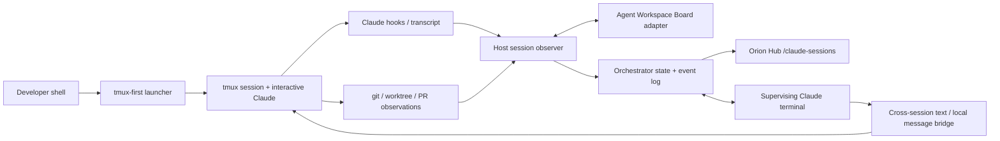

# Development session orchestrator (split from Orion Prime, Phase 1)

**Design specification · 2026-10-29 (split 2026-10-30) · Proposal, design only**
**Scope:** host-local coordination of interactive Claude Code sessions in Orion Hub: tmux persistence, a session read model, duplicate-work detection, cross-session messaging.
**Split note:** this was Phase 1 of `2026-10-29-orion-prime-two-phase-orchestration-design.md`. Juniper split the two on 2026-10-30. Orion Prime (Orion's cognition) is now `2026-10-29-orion-prime-design.md`. The two documents have no rollout dependency on each other. They share no credentials, permissions or terminal capabilities.

## 1. Decision

Build a host-local, Hub-visible control plane for every interactive Claude Code session: its worktree, prompts, tasks, PRs, spawned agents, transcript activity and cross-session coordination. It prevents duplicate work where evidence supports that, relays findings, and removes the need for a human to remember 15 concurrent workstreams. `tmux` gives terminal persistence. The existing Agent Workspace Board gives the first state ledger. The orchestrator gives intent, arbitration and communication.

## 2. The problem

With 15+ concurrent sessions, each session sees only part of the engineering situation. Duplicate PR implementation, competing edits, abandoned findings, hidden blockers, worktree ownership confusion and stale assumptions accumulate. A terminal multiplexor solves *persistence* but not *shared understanding*. A status board solves *visibility* but not *coordination*. A central Claude with no event history solves neither reliably.

**Target operator experience:** on a new task, the system can identify a similar active task, query its owner, identify which requirement is already covered, propose a complementary task, and record the coordination result. Hub shows the workstream graph and allows operator interventions. The system communicates with agents without moving entire work products between sessions.

## 3. Shared invariants

- **Persistent identity is not a model context window.** A session or kernel has a stable ID, state revision, provenance, history and lifecycle independent of its currently invoked LLM.
- **Observe → imagine/predict → negotiate → select → act → encounter consequences → revise** is the shared recurrence. Deterministic coordination and model inference are complementary, not interchangeable.
- **A projection is not a second source of truth.** The original subsystem owns its state; the orchestrator maintains derived, versioned views and records decisions.
- **A model can initiate and contest, but canonical owners commit.** The supervising model is an active participant; schema, version, authorization and provenance boundaries protect irreversible facts and actions.
- **Coordination has evidence and room for new organization.** Record sources, negotiations, interventions, predicted effects and actual effects. Do not predetermine every emergent coalition or concern category.
- **Resource governance is explicit.** Work has urgency, deadline, allowed tools/model, budget, cancellation and retry policy; the cost and thermal footprint are visible.
- **Fail in a stated mode.** Degraded telemetry is surfaced as degraded telemetry, not interpreted as inactivity, absence of conflict, or a healthy cognitive state.

## 4. Grounding

| Existing capability | Evidence in repository | Design consequence |
|---|---|---|
| Agent Workspace Board | `scripts/agent_board.py`, `scripts/agent_board_lib.py`, SessionStart/Stop adapters; JSONL at `~/.orion/agent-board.jsonl`; PR report `docs/superpowers/pr-reports/2026-07-16-agent-workspace-board-pr.md` | Extend the board's state model and adapters; do not create a competing host-local presence ledger. Existing records are per-worktree, not per live terminal. |
| Claude hook wiring | `.claude/settings.json` already wires session-start board/worktree checks, Stop hooks, tool guards | Add narrowly scoped adapters alongside, not instead of, existing hooks. Maintain `ORION_FCC_SUBPROCESS` exclusion: chat-turn `claude -p` workers are not developer terminals. |
| Orion Hub | `services/orion-hub/README.md`; FastAPI, WebSocket, bus-facing panels | Hub hosts the visible control plane; host observer owns `tmux` and transcript file access. No mounting user CLI credentials/sockets into Hub. |

**Verification boundary:** the repository surfaces above were inspected through the connected GitHub main branch. They establish design affordances and historical implementation reports, not live service health, current production data or the presence of the previously drafted Claude/tmux patch on main. Exact contracts and runtime feature flags must be confirmed during implementation.

## 5. Shared coordination substrate (v1; independent of Claude and Orion cognition)

The reusable unit is a **work-bearing entity**. In Phase 1 it is a developer session or task; in Phase 2 it is a kernel, cognitive episode or leased worker. Keep the shared envelope small and let domain-specific schemas carry interpretation.

### 5.1 Required IDs and relations

- `entity_id`: stable session/kernel/worker ID; never reuse after restart.
- `logical_scope_id`: workstream or cognitive domain; many entities can join one scope.
- `objective_id`: stable work-intent or open-loop ID; supports duplicate/cross-domain linking.
- `event_id`, `correlation_id`, `causation_id`: immutable provenance spine.
- `state_revision`: monotonically increasing per authoritative entity; compare-and-swap on update.
- `source_ref`: resolvable source references to board events, transcript offsets, git commits, PRs, attention rows, memory evidence, temporal arcs, etc.
- `authority_class`: observe, propose, coordinate, execute, approve-only.

### 5.2 Minimal shared event envelope — illustrative new contract

```json
{
  "schema": "orion.coordination.event.v1",
  "event_id": "uuid",
  "occurred_at": "2026-10-29T22:00:00Z",
  "domain": "development",
  "entity_id": "session:hostA:opaque-id",
  "logical_scope_id": "workstream:hub-sessions",
  "objective_id": "objective:uuid",
  "state_revision": 17,
  "event_type": "intent.updated",
  "correlation_id": "uuid",
  "causation_id": "uuid-or-null",
  "source_refs": ["board:event:uuid", "git:commit:sha"],
  "payload": {"summary": "Implement session dashboard"}
}
```

Names here are **proposed**, not existing registered bus schemas. Register producer and consumer contracts in Orion's actual schema registry and channel catalog only after inspecting compatible conventions. A small common envelope is the goal; avoid a universal ontology of all cognitive activity.

### 5.3 State machine and delivery semantics

`observed → registered → active → (blocked | waiting | suspended) → completed | cancelled | failed | stale`

- Source events append once by `event_id`. Projections rebuild idempotently; duplicate delivery is normal.
- Agents/workers send heartbeats and explicit state transitions. A stale heartbeat is `unknown/stale`, not `stopped`.
- Commands use unique `command_id`, target `state_revision`, expiration, actor and policy; ack includes accepted/rejected reason. A side effect executes at most once per command ID even if its message is redelivered.
- Communications use an outbox with delivery attempts and receipt. `delivered` does not imply `read`, `understood`, `accepted`, or `acted on`.
- Multi-process proposals are reconciled by source owners: no global write-all operation.
- Snapshots include `observed_at`, `watermark`, dropped-event counts, freshness and confidence.

### 5.4 Components shared logically, not necessarily physically

`ObserverAdapter`, `StateProjection`, `IntentIndex`, `ArbitrationPolicy`, `PeerMessageRouter`, `DispatchAdapter`, `Reconciler`, `AuditLedger`, `HubReadModel` and a **recurrent supervising model**. Implement them as small modules backed by the board and a host agent. This design must test **proactive model-led supervision and lateral negotiation**, not only passive visibility. Nothing here is reused by Orion Prime's runtime.

## 6. The orchestrator

### 6.1 Desired operator behavior

1. Launch `claude` normally through an installed shell shim/wrapper that **creates or enters a tmux session before starting** the interactive Claude process. Example conceptual interface: `oclaude [args]`, with an optional shell alias or function named `claude`; preserve an escape hatch for the raw binary. Re-running from an existing `tmux` pane must not recursively nest sessions. Distinguish fresh start from reattach and from Claude's `--resume`.
2. The wrapper registers `{host, tmux session/pane, PID, cwd, worktree, branch, start time}` before invocation and reconciles the real Claude `session_id` on `SessionStart`. It handles one-to-many: one worktree can contain multiple live Claude sessions.
3. Disconnect/SSH exit leaves the live Claude process in tmux. Operator can reattach via SSH, terminal, or later an authenticated Hub terminal panel.
4. Host-side observer ingests hook events, Claude's JSONL transcript append deltas where available, tool/subagent lifecycle, git/worktree/PR status, background agents and Agent Workspace Board records. It produces a bounded, searchable read model in Hub.
5. Hub groups by **workstream**, then shows separate sessions, threads, branches and tasks. Each row shows whether information is live, inferred or stale.
6. A dedicated orchestrator Claude terminal operates with scoped access to the read model, can ask other sessions for status, and can propose or perform policy-authorized coordination actions. A non-LLM supervisor keeps operating when that terminal is closed.

### 6.2 Terminal ownership and ingestion



**Cannot retrofit:** Claude's SessionStart hook fires after launch and cannot safely move an existing interactive process into a new tmux TTY. The launcher must wrap the process at entry. Unwrapped sessions remain discoverable where possible but are labeled `unmanaged`, not falsely `persistent`.

**Hook plan:** `SessionStart` binds Claude `session_id` and transcript path; `UserPromptSubmit` extracts proposed intent and performs fast work admission; `PreToolUse` can enforce scoped file/PR ownership at actual mutation points; `PostToolUse`/`PostToolUseFailure` record activity; `SubagentStart`/`SubagentStop` record children; `Stop` marks an answer-turn boundary, **not** session destruction; `SessionEnd` closes the process record. Other supported task lifecycle hooks can enrich the graph. Install adapters without overwriting existing `.claude/settings.json` hook arrays and avoid requiring chat models to emit status manually.

**Transcript correctness:** incremental ingestion by per-file inode/offset, tolerant of rotated/truncated files and partial JSON lines. Separate user, assistant, tool call/result, and system metadata. Track `last_ingested_offset` and parse quality. Secrets redacted at source/egress. A transcript is evidence of *said* or *attempted*, not proof a tool succeeded.

**Claude integration constraint:** Claude Code's `ListAgents`/`SendMessage` are model-facing tools for Claude sessions, not a general documented daemon API that Hub should assume it can invoke programmatically. Use native messaging when a Claude supervisor session is present. Add a reliable, vendor-neutral host mailbox/command bridge for acknowledgement, retries, offline sessions, and later non-Claude agents. Native messages contain text only; they don't transfer full histories or files. Agent teams are separate and experimental; do not assume cross-session messaging implies all Claude agent-team capabilities.

### 6.3 Intent discovery and duplicate-work adjudication

Intent is structured and periodically refreshed, not inferred once from a session title:

```json
{
  "intent_id": "uuid",
  "session_id": "opaque",
  "goal": "Add a Hub panel for Claude sessions",
  "scope": ["services/orion-hub", "scripts"],
  "deliverable": {"kind": "pr", "ref": null},
  "worktree": "/path/to/worktree",
  "stage": "implementing",
  "related_prs": [1234],
  "evidence_refs": ["transcript:...", "board:event:..."],
  "verified_at": "2026-10-29T22:00:00Z",
  "confidence": 0.83
}
```

Use deterministic candidates first: same PR, issue, worktree, exact file/path scope, branch lineage, and known task IDs. Use semantic retrieval for ambiguous intent, then **verify the apparent overlap by questioning the owner and inspecting evidence**. Do not call similar vocabulary a duplicate.

| Finding | Default behavior | Why |
|---|---|---|
| Exact same registered objective/PR actively owned elsewhere | Hold new execution pending owner verification; suggest reuse/handoff/division; operator override with receipt | Strong collision evidence |
| Competing edit of protected file or incompatible migration | PreToolUse deny or require owner coordination until conflict resolved | Actual mutation boundary; more reliable than prompt-only semantic checks |
| High semantic overlap, disjoint outputs plausible | Advisory investigation; allow continued read-only discovery | High false-positive cost |
| Unknown board/observer, missing data, unreachable owner | Display uncertainty; default advisory; retain guard for known destructive conflicts | Avoid false certainty or deadlocking normal work |

A `UserPromptSubmit` gate may reject a prompt with a clear remediation message, but should not block unrelated follow-up questions or every message in an ongoing session. The authoritative gate for risky edits sits at the relevant tool boundary. Every block supports a time-bounded user override that is explicit, auditable and scoped to one work item/action.

### 6.4 Cross-session collaboration protocol

Proposed commands: `status.request`, `status.reply`, `finding.share`, `dependency.declare`, `ownership.request`, `ownership.grant`, `scope.reconcile`, `handoff.request`, `handoff.accept`, `operator.override`. Each message carries sender, recipient, workstream, correlation, evidence, TTL, permissions and receipt status. Message routers must not automatically treat an agent's self-report as authoritative: verify important claims against git, tests, PR state and tool receipts.

**Example: session 16 duplicates session 7**

1. Session 16's new prompt causes an intent candidate to be created before the implementation begins.
2. Intent index finds session 7's PR, code paths and current objective; policy pauses protected writes, not harmless inquiry.
3. Supervisor asks session 7 what is completed and whether the new requirement is covered. Reply is correlated and evidence checked.
4. Supervisor resolves ownership: session 7 adds the missing requirement; session 16 is offered testing or an unrelated task; no autonomous full-context takeover.
5. Hub shows the overlap evidence, messages, approved ownership revision and measured duplicate work avoided.
6. If session 7 is stale/unresponsive, the orchestrator proposes a new owner with a documented expiry and explicit override path.

### 6.5 Hub experience

**New `/claude-sessions` workspace:** grouped workstream board; active/stale/unmanaged sections; owner, status, elapsed time, PR, branch, worktree, last verified task, last conversation activity, model/tool and child-agent activity. Navigation to conversation timeline, tool receipts and source evidence. A dependency/conflict graph and coordination activity stream are second panels, not a new independent backend ledger.

**Hub orchestrator panel:** ask natural questions, see provenance-bearing answers, contact selected sessions, and view proposed/committed actions. Controls: focus, message, request status, create complementary task, request pause, release ownership, cancel work, request handoff, approve override, open terminal. Use least-privilege per action. Live terminal interaction (e.g. authenticated WebSocket PTY) is a separate release gate; never expose raw tmux socket or general shell via an unauthenticated browser route.

**Security:** trusted local/Tailscale access is a baseline, not a substitute for authenticating privileged control actions. Token/CSRF/origin controls, actor logs, host-side allowlisted command adapter, narrow executable commands and rate limits. Sanitize terminal escape output and untrusted transcript text. No automatic merge/deletion/rebase/push without operator grant. Avoid exposing full transcripts to all Hub users or logging credentials.

### 6.6 Acceptance and metrics

**Functionality gates:** (P1-G1) new interactive session always starts in tmux under the supported launcher; reattach survives SSH detach; unmanaged launches are clearly flagged. (G2) two sessions in one worktree remain separate while board metadata is shared. (G3) stale and crashed observers reconstruct state without phantom active sessions. (G4) a 15-session seeded scenario discovers exact duplicate work and blocks conflicting writes, while disjoint tasks pass. (G5) cross-session queries are delivered with verified responses and tracked failure handling. (G6) Hub refresh is near-real-time and auditable, including agent/subagent nesting. (G7) role/authorization tests prevent transcript and terminal access outside scope.

**Measures:** true/false positive duplicate detections, precision/recall at declared thresholds, unnecessary blocks per 100 prompts, median detection delay, coordination round-trip time, proportion of tools/transcript events captured, orphaned tasks, PR/file edit collisions, operator recovery time, time spent identifying active ownership, avoided duplicate effort, orchestration token cost. Collect before/after baseline and controlled replay with coordination disabled.

**Deliverables:** host launcher/installer; hook adapters; host observer daemon; board-compatible session registry; message bridge and orchestrator command API; Hub route and UI; tests/fixtures; migration/rollback instructions; operator runbook. Treat earlier Phase 1 ZIP/patch as candidate input to review and reconcile, not as source-of-truth code already on main.

## 7. Rollout

| Increment | Deliverable | Promotion requirement |
|---|---|---|
| 1A — Terminal substrate | Launcher, tmux persistence, per-session IDs, observer, legacy board adapter | 2 sessions/1 worktree and 15-session stress fixture, no phantom presence |
| 1B — Hub read model | Live sessions, task/PR/activity timeline, searchable transcripts and provenance | Security/freshness and restart tests |
| 1C — Active development coordination | Warm supervising Claude with proactive conflict detection, agent-to-agent negotiation, bounded override, reliable mailbox and collision guards | Supervisor catches duplication *without being asked*, visibly influences peer work, accepts agent corrections; audited interventions |
| 1D — Measured ecology prototype | Replays, telemetry, peer coalitions, active supervisor vs passive dashboard ablations and extracted shared contracts | Demonstrated net benefit from *active recurrent and lateral coordination*, not only centralized observability |

Shadow first. Read-only before mutation. Feature flags allow instant fallback to existing behavior.

## 8. Risks and non-goals

| Risk | Design response |
|---|---|
| Native Claude messaging is incomplete | Use its model-facing tools opportunistically; host mailbox is authoritative for delivery and receipts |
| False duplicate-work blocks development | Distinguish exact conflict from semantic overlap, short timeout, scoped overrides, measure false positives |

Out of scope: auto-merge, broad unattended filesystem control, migrating a running terminal process into tmux, any write path into Orion cognition.

## 9. Decisions and open questions

**Proposed locked principles:** (D1) Hub is the operator-facing read model and command surface. It does not own Claude processes. (D2) A Claude Stop hook is not session end. (D3) This orchestrator and Orion Prime use separate authorization domains.

1. Which Claude Code features and hook payload fields are installed on each actual host? Check `claude --version`, command/hook behavior and current permissions in a fixture; the docs describe version-dependent features.
2. Which Phase 1 patch bundle parts differ from current `main`, and which should be revised or discarded?
3. Where should development session transcripts be stored, who can access them, and what is the retention/redaction policy?

## 10. Source references

- [Agent Workspace Board design](https://github.com/junebug-junie/Orion-Sapienform/blob/main/docs/superpowers/specs/2026-07-16-agent-workspace-board-design.md) and [implementation PR report](https://github.com/junebug-junie/Orion-Sapienform/blob/main/docs/superpowers/pr-reports/2026-07-16-agent-workspace-board-pr.md)
- [Existing Claude hook configuration](https://github.com/junebug-junie/Orion-Sapienform/blob/main/.claude/settings.json) and [SessionStart agent board adapter](https://github.com/junebug-junie/Orion-Sapienform/blob/main/scripts/hooks/session_start_agent_board.py)

**Current Claude Code documentation (checked 2026-10-29):**

- [Hooks reference](https://code.claude.com/docs/en/hooks)
- [Cross-session messaging](https://code.claude.com/docs/en/cross-session-messaging): native `ListAgents` / `SendMessage`, text-only messages, version/provider constraints
- [Agent teams](https://code.claude.com/docs/en/agent-teams): experimental feature separate from arbitrary cross-session messaging
