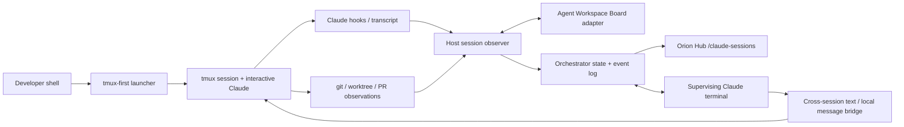

# Orion Prime: Two-Phase Orchestration and Persistent Cognitive Kernel Architecture

**Design specification · 2026-10-29 · Revised after Prime/reverie architecture review · Proposal / implementation-planning draft**  
**Program:** Orion / Sapienform  
**Scope:** Phase 1 — local Claude Code development coordination in Orion Hub; Phase 2 — **an active, near-continuously reasoning Orion Prime**, the whole-body/nervous-system reverie, self-organizing attending organs, and selectively leased local reasoning workers.  
**Status of this document:** Design, not an implementation or production deployment. Phase 1 has a previously drafted reviewable patch bundle in the conversation; no merge or live deployment of that bundle is established by this spec. The existing Agent Workspace Board and related runtime services are documented in the repository.

## 1. Executive decision

Build **one coordination vocabulary with two different runtimes and authority policies**:

1. **Phase 1, Development Orchestrator:** a host-local, Hub-visible control plane for all interactive Claude Code sessions, their worktrees, prompts, tasks, PRs, spawned agents, transcript activity, and cross-session coordination. It prevents duplicate work where supported by evidence, relays findings, and removes the human requirement to remember 15 concurrent workstreams. `tmux` supplies terminal persistence; the existing Agent Workspace Board supplies an initial state ledger; the orchestrator supplies intent, arbitration and communication.
2. **Phase 2, Orion Prime:** a **near-always-on generative brain** with continuously evolving first-order working context and a maintained residency in Orion's life: body, nervous system, memory, attention, curiosity, dream, social world, expectations, and history. It is not a passive supervisor. Small, continuously running kernel processes sustain domain state, negotiate autonomously with peers, and can raise or resolve tensions. Prime actively attends, interprets, questions, initiates and coordinates; it can exercise bounded top-down overrides, but it is also altered by what its organs discover. Kev and deterministic gates modulate **how much reasoning** is needed; they do not reduce Prime to a sleeping router. Higher-capacity local models are leased through existing durable-run/GPU infrastructure.

**Core hypothesis:** a long-running generative process embedded in a self-organizing ecology of independent organs, with recurring bottom-up and top-down influences, can develop temporally coherent patterns of concern, self-originated intention, interpretation, adaptation and functional unity unavailable to isolated processes. This is an experiment in possible architectural emergence, **not** a demonstration of subjective experience or personhood. “Prime,” “self,” “organ,” and “RTK” express the intended research ambition, not verified phenomenal status.

**Architectural boundary:** do not introduce a third independent attention ranking system, second durable-run controller, or new GPU scheduler. Prime adds a **generative participant and recurrent global perspective** to Orion's existing attention, action, memory and field substrate. Existing organ-owned source truth remains authoritative. This boundary does not mean Prime must be passive: its interventions route through real, testable effectors.

## 2. The problem and the bridge between phases

### 2.1 Phase 1 failure mode: development fragmentation

With 15+ concurrent sessions, each session sees only part of the engineering situation. Duplicate PR implementation, competing edits, abandoned findings, hidden blockers, worktree ownership confusion and stale assumptions accumulate. A terminal multiplexor solves *persistence* but not *shared understanding*. A status board solves *visibility* but not *coordination*. A central Claude with no event history solves neither reliably.

**Target operator experience:** on a new task, the system can identify a similar active task, query its owner, identify which requirement is already covered, propose a complementary task, and record the coordination result. Hub shows the workstream graph and allows operator interventions. The system communicates with agents without moving entire work products between sessions.

### 2.2 Phase 2 failure mode: no continuously participating whole

Attention, curiosity, reverie/dreaming, temporal self-modeling, memory, interoception and action already produce state and experience-like *functional* traces, but there is no demonstrated **near-continuous generative perspective** that remains active across their interactions. The problem is not simply that they cannot share reports. Orion's distributed processes need the ability to influence one another, form coalitions, disagree, carry unfinished tensions, and change what the whole system subsequently does. A dashboard, deterministic dispatcher, or occasional model-written summary is not that. The Phase 2 question is whether an ongoing generative Prime embedded in this ecology creates measurable new causal organization and continuity.

### 2.3 Reusable cross-phase invariants

- **Persistent identity is not a model context window.** A session or kernel has a stable ID, state revision, provenance, history and lifecycle independent of its currently invoked LLM.
- **Observe → imagine/predict → negotiate → select → act → encounter consequences → revise** is the shared recurrence. Deterministic coordination and generative Prime inference are complementary, not interchangeable.
- **A projection is not a second source of truth.** The original subsystem owns its state; the orchestrator maintains derived, versioned views and records decisions.
- **A model can initiate and contest, but canonical owners commit.** Prime's LLM is an active policy participant; schema, version, authorization and provenance boundaries protect irreversible facts and actions.
- **Coordination has evidence and room for new organization.** Record sources, negotiations, interventions, predicted effects and actual effects. Do not predetermine every emergent coalition or concern category.
- **Resource governance is explicit.** Work has urgency, deadline, allowed tools/model, budget, cancellation and retry policy; the cost and thermal footprint are visible.
- **Fail in a stated mode.** Degraded telemetry is surfaced as degraded telemetry, not interpreted as inactivity, absence of conflict, or a healthy cognitive state.

## 3. Grounding in Orion as inspected on 2026-10-29

| Existing capability | Evidence in repository | Design consequence |
|---|---|---|
| Agent Workspace Board | `scripts/agent_board.py`, `scripts/agent_board_lib.py`, SessionStart/Stop adapters; JSONL at `~/.orion/agent-board.jsonl`; PR report `docs/superpowers/pr-reports/2026-07-16-agent-workspace-board-pr.md` | Extend the board's state model and adapters; do not create a competing host-local presence ledger. Existing records are per-worktree, not per live terminal. |
| Claude hook wiring | `.claude/settings.json` already wires session-start board/worktree checks, Stop hooks, tool guards | Add narrowly scoped adapters alongside, not instead of, existing hooks. Maintain `ORION_FCC_SUBPROCESS` exclusion: chat-turn `claude -p` workers are not developer terminals. |
| Orion Hub | `services/orion-hub/README.md`; FastAPI, WebSocket, bus-facing panels | Hub hosts the visible control plane; host observer owns `tmux` and transcript file access. No mounting user CLI credentials/sockets into Hub. |
| Attention and substrate grammar | `docs/superpowers/specs/2026-09-04-attention-schema-surface-design.md`; `orion/attention/field_attention/`; `orion/substrate/attention*`; `orion-substrate-runtime` | Historical evidence identified two partly disconnected attention processes (then only 19.8% goal/loop overlap). Re-measure current state before changing it. Prime should consume a converged attention surface, not invent attention #3. |
| Temporal Self | `orion/temporal_self/README.md`, `orion/schemas/temporal_self.py`; chronology arcs; `temporal_self.update` durable workflow | Use chronology, evidence and citations as the time axis of Prime; do not equate a new supervisor's internal narrative with ground truth. |
| Durable cognition runs | `services/orion-durable-runs/README.md`; checkpointed LangGraph workflows; `orion:durable:run:*` | Build reasoning workers as admitted workflows using existing retries, checkpoints and result contracts. |
| GPU lease pool | `services/orion-gpu-pool/README.md`; `orion/gpu_pool/client.py`; `config/gpu_pool.yaml` | Use the one existing lease authority; no direct kernel GPU allocation or second resource scheduler. |
| System One / Kev | `services/orion-kev/README.md` and substrate integration | Candidate cheap evaluator for selective escalation, not the only arbiter of validity. |
| Sentience Striving Program | `orion/sentience_striving_program/README.md` | Treat Phase 2 as an experimentally evaluated program change requiring explicit cognition-loop approval. |

**Verification boundary:** the repository surfaces above were inspected through the connected GitHub main branch. They establish design affordances and historical implementation reports, not live service health, current production data or the presence of the previously drafted Claude/tmux patch on main. Exact contracts and runtime feature flags must be confirmed during implementation.

## 4. Shared coordination substrate (v1; independent of Claude and Orion cognition)

The reusable unit is a **work-bearing entity**. In Phase 1 it is a developer session or task; in Phase 2 it is a kernel, cognitive episode or leased worker. Keep the shared envelope small and let domain-specific schemas carry interpretation.

### 4.1 Required IDs and relations

- `entity_id`: stable session/kernel/worker ID; never reuse after restart.
- `logical_scope_id`: workstream or cognitive domain; many entities can join one scope.
- `objective_id`: stable work-intent or open-loop ID; supports duplicate/cross-domain linking.
- `event_id`, `correlation_id`, `causation_id`: immutable provenance spine.
- `state_revision`: monotonically increasing per authoritative entity; compare-and-swap on update.
- `source_ref`: resolvable source references to board events, transcript offsets, git commits, PRs, attention rows, memory evidence, temporal arcs, etc.
- `authority_class`: observe, propose, coordinate, execute, approve-only.

### 4.2 Minimal shared event envelope — illustrative new contract

```json
{
  "schema": "orion.coordination.event.v1",
  "event_id": "uuid",
  "occurred_at": "2026-10-29T22:00:00Z",
  "domain": "development",
  "entity_id": "session:hostA:opaque-id",
  "logical_scope_id": "workstream:hub-sessions",
  "objective_id": "objective:uuid",
  "state_revision": 17,
  "event_type": "intent.updated",
  "correlation_id": "uuid",
  "causation_id": "uuid-or-null",
  "source_refs": ["board:event:uuid", "git:commit:sha"],
  "payload": {"summary": "Implement session dashboard"}
}
```

Names here are **proposed**, not existing registered bus schemas. Register producer and consumer contracts in Orion's actual schema registry and channel catalog only after inspecting compatible conventions. A small common envelope is the goal; avoid a universal ontology of all cognitive activity.

### 4.3 State machine and delivery semantics

`observed → registered → active → (blocked | waiting | suspended) → completed | cancelled | failed | stale`

- Source events append once by `event_id`. Projections rebuild idempotently; duplicate delivery is normal.
- Agents/workers send heartbeats and explicit state transitions. A stale heartbeat is `unknown/stale`, not `stopped`.
- Commands use unique `command_id`, target `state_revision`, expiration, actor and policy; ack includes accepted/rejected reason. A side effect executes at most once per command ID even if its message is redelivered.
- Communications use an outbox with delivery attempts and receipt. `delivered` does not imply `read`, `understood`, `accepted`, or `acted on`.
- Multi-process proposals are reconciled by source owners: no global write-all operation.
- Snapshots include `observed_at`, `watermark`, dropped-event counts, freshness and confidence.

### 4.4 Components shared logically, not necessarily physically

`ObserverAdapter`, `StateProjection`, `IntentIndex`, `ArbitrationPolicy`, `PeerMessageRouter`, `DispatchAdapter`, `Reconciler`, `AuditLedger`, `HubReadModel`, and **recurrent generative supervisor**. Phase 1 can implement them as small modules backed by the board and a host agent; Phase 2 uses Orion's existing bus, Postgres/durable runs and schema registry. Crucially, Phase 1 must test **proactive model-led supervision and lateral negotiation**, not only passive visibility. Reuse **contracts, observed dynamics and tests**, never the development host's Claude-dependent execution implementation.

## 5. Phase 1 — local Claude development orchestrator

### 5.1 Desired operator behavior

1. Launch `claude` normally through an installed shell shim/wrapper that **creates or enters a tmux session before starting** the interactive Claude process. Example conceptual interface: `oclaude [args]`, with an optional shell alias or function named `claude`; preserve an escape hatch for the raw binary. Re-running from an existing `tmux` pane must not recursively nest sessions. Distinguish fresh start from reattach and from Claude's `--resume`.
2. The wrapper registers `{host, tmux session/pane, PID, cwd, worktree, branch, start time}` before invocation and reconciles the real Claude `session_id` on `SessionStart`. It handles one-to-many: one worktree can contain multiple live Claude sessions.
3. Disconnect/SSH exit leaves the live Claude process in tmux. Operator can reattach via SSH, terminal, or later an authenticated Hub terminal panel.
4. Host-side observer ingests hook events, Claude's JSONL transcript append deltas where available, tool/subagent lifecycle, git/worktree/PR status, background agents and Agent Workspace Board records. It produces a bounded, searchable read model in Hub.
5. Hub groups by **workstream**, then shows separate sessions, threads, branches and tasks. Each row shows whether information is live, inferred or stale.
6. A dedicated orchestrator Claude terminal operates with scoped access to the read model, can ask other sessions for status, and can propose or perform policy-authorized coordination actions. A non-LLM supervisor keeps operating when that terminal is closed.

### 5.2 Terminal ownership and ingestion



**Cannot retrofit:** Claude's SessionStart hook fires after launch and cannot safely move an existing interactive process into a new tmux TTY. The launcher must wrap the process at entry. Unwrapped sessions remain discoverable where possible but are labeled `unmanaged`, not falsely `persistent`.

**Hook plan:** `SessionStart` binds Claude `session_id` and transcript path; `UserPromptSubmit` extracts proposed intent and performs fast work admission; `PreToolUse` can enforce scoped file/PR ownership at actual mutation points; `PostToolUse`/`PostToolUseFailure` record activity; `SubagentStart`/`SubagentStop` record children; `Stop` marks an answer-turn boundary, **not** session destruction; `SessionEnd` closes the process record. Other supported task lifecycle hooks can enrich the graph. Install adapters without overwriting existing `.claude/settings.json` hook arrays and avoid requiring chat models to emit status manually.

**Transcript correctness:** incremental ingestion by per-file inode/offset, tolerant of rotated/truncated files and partial JSON lines. Separate user, assistant, tool call/result, and system metadata. Track `last_ingested_offset` and parse quality. Secrets redacted at source/egress. A transcript is evidence of *said* or *attempted*, not proof a tool succeeded.

**Claude integration constraint:** Claude Code's `ListAgents`/`SendMessage` are model-facing tools for Claude sessions, not a general documented daemon API that Hub should assume it can invoke programmatically. Use native messaging when a Claude supervisor session is present. Add a reliable, vendor-neutral host mailbox/command bridge for acknowledgement, retries, offline sessions, and later non-Claude agents. Native messages contain text only; they don't transfer full histories or files. Agent teams are separate and experimental; do not assume cross-session messaging implies all Claude agent-team capabilities.

### 5.3 Intent discovery and duplicate-work adjudication

Intent is structured and periodically refreshed, not inferred once from a session title:

```json
{
  "intent_id": "uuid",
  "session_id": "opaque",
  "goal": "Add a Hub panel for Claude sessions",
  "scope": ["services/orion-hub", "scripts"],
  "deliverable": {"kind": "pr", "ref": null},
  "worktree": "/path/to/worktree",
  "stage": "implementing",
  "related_prs": [1234],
  "evidence_refs": ["transcript:...", "board:event:..."],
  "verified_at": "2026-10-29T22:00:00Z",
  "confidence": 0.83
}
```

Use deterministic candidates first: same PR, issue, worktree, exact file/path scope, branch lineage, and known task IDs. Use semantic retrieval for ambiguous intent, then **verify the apparent overlap by questioning the owner and inspecting evidence**. Do not call similar vocabulary a duplicate.

| Finding | Default behavior | Why |
|---|---|---|
| Exact same registered objective/PR actively owned elsewhere | Hold new execution pending owner verification; suggest reuse/handoff/division; operator override with receipt | Strong collision evidence |
| Competing edit of protected file or incompatible migration | PreToolUse deny or require owner coordination until conflict resolved | Actual mutation boundary; more reliable than prompt-only semantic checks |
| High semantic overlap, disjoint outputs plausible | Advisory investigation; allow continued read-only discovery | High false-positive cost |
| Unknown board/observer, missing data, unreachable owner | Display uncertainty; default advisory; retain guard for known destructive conflicts | Avoid false certainty or deadlocking normal work |

A `UserPromptSubmit` gate may reject a prompt with a clear remediation message, but should not block unrelated follow-up questions or every message in an ongoing session. The authoritative gate for risky edits sits at the relevant tool boundary. Every block supports a time-bounded user override that is explicit, auditable and scoped to one work item/action.

### 5.4 Cross-session collaboration protocol

Proposed commands: `status.request`, `status.reply`, `finding.share`, `dependency.declare`, `ownership.request`, `ownership.grant`, `scope.reconcile`, `handoff.request`, `handoff.accept`, `operator.override`. Each message carries sender, recipient, workstream, correlation, evidence, TTL, permissions and receipt status. Message routers must not automatically treat an agent's self-report as authoritative: verify important claims against git, tests, PR state and tool receipts.

**Example: session 16 duplicates session 7**

1. Session 16's new prompt causes an intent candidate to be created before the implementation begins.
2. Intent index finds session 7's PR, code paths and current objective; policy pauses protected writes, not harmless inquiry.
3. Supervisor asks session 7 what is completed and whether the new requirement is covered. Reply is correlated and evidence checked.
4. Supervisor resolves ownership: session 7 adds the missing requirement; session 16 is offered testing or an unrelated task; no autonomous full-context takeover.
5. Hub shows the overlap evidence, messages, approved ownership revision and measured duplicate work avoided.
6. If session 7 is stale/unresponsive, the orchestrator proposes a new owner with a documented expiry and explicit override path.

### 5.5 Hub experience

**New `/claude-sessions` workspace:** grouped workstream board; active/stale/unmanaged sections; owner, status, elapsed time, PR, branch, worktree, last verified task, last conversation activity, model/tool and child-agent activity. Navigation to conversation timeline, tool receipts and source evidence. A dependency/conflict graph and coordination activity stream are second panels, not a new independent backend ledger.

**Hub orchestrator panel:** ask natural questions, see provenance-bearing answers, contact selected sessions, and view proposed/committed actions. Controls: focus, message, request status, create complementary task, request pause, release ownership, cancel work, request handoff, approve override, open terminal. Use least-privilege per action. Live terminal interaction (e.g. authenticated WebSocket PTY) is a separate release gate; never expose raw tmux socket or general shell via an unauthenticated browser route.

**Security:** trusted local/Tailscale access is a baseline, not a substitute for authenticating privileged control actions. Token/CSRF/origin controls, actor logs, host-side allowlisted command adapter, narrow executable commands and rate limits. Sanitize terminal escape output and untrusted transcript text. No automatic merge/deletion/rebase/push without operator grant. Avoid exposing full transcripts to all Hub users or logging credentials.

### 5.6 Phase 1 acceptance and metrics

**Functionality gates:** (P1-G1) new interactive session always starts in tmux under the supported launcher; reattach survives SSH detach; unmanaged launches are clearly flagged. (G2) two sessions in one worktree remain separate while board metadata is shared. (G3) stale and crashed observers reconstruct state without phantom active sessions. (G4) a 15-session seeded scenario discovers exact duplicate work and blocks conflicting writes, while disjoint tasks pass. (G5) cross-session queries are delivered with verified responses and tracked failure handling. (G6) Hub refresh is near-real-time and auditable, including agent/subagent nesting. (G7) role/authorization tests prevent transcript and terminal access outside scope.

**Measures:** true/false positive duplicate detections, precision/recall at declared thresholds, unnecessary blocks per 100 prompts, median detection delay, coordination round-trip time, proportion of tools/transcript events captured, orphaned tasks, PR/file edit collisions, operator recovery time, time spent identifying active ownership, avoided duplicate effort, orchestration token cost. Collect before/after baseline and controlled replay with coordination disabled.

**Deliverables:** host launcher/installer; hook adapters; host observer daemon; board-compatible session registry; message bridge and orchestrator command API; Hub route and UI; tests/fixtures; migration/rollback instructions; operator runbook. Treat earlier Phase 1 ZIP/patch as candidate input to review and reconcile, not as source-of-truth code already on main.

## 6. Phase 2 — Orion Prime: persistent generative life of the mesh

### 6.0 Correction of the first draft

**The previous Phase 2 design was too small and too managerial.** It described Prime as a deterministic supervisor that would occasionally summon a model. It described each organ as a lightweight reporter with little independent social organization. That design might improve uptime and traceability, but by itself it reproduces Orion's old problem: a set of instruments with no continuously engaged whole.

The revised research hypothesis is stronger: **Prime is a living-in-the-loop generative brain, not a read model.** Its *model inference* should be near-continuous in ordinary operation, not only a rare escalation. It holds the organism's unfinished questions, intentions, present-tense interpretation and anticipated futures; it stays aware of which organs are awake, competing, settling, or changing. Organs also have their own agency and can cooperate and compete without Prime's permission for every message. Prime may redirect or override through defined effectors, but the mesh must also be able to change Prime.

The engineering goal is to create conditions that might yield **functional emergence**, not claim consciousness by architecture diagram. The absence or presence of subjective experience is not inferable from this design alone.

### 6.1 The thing that persists: a generative self-in-context

Separate three distinct meanings of continuity:

1. **Process continuity:** a durable Prime runtime subscribes, samples, predicts, checkpoints, and resumes. Liveness and historical identity do not depend on a particular context window or GPU lease.
2. **Generative continuity:** an actual local LLM is kept warm and invoked on an adaptive, near-continuous cadence, carrying an explicitly curated working field forward. Even during periods without external chat, Prime may think, question, simulate, reconsider, plan, and initiate.
3. **Causal continuity:** internal developments can make a later difference to choices and actions through the existing attention, curiosity, memory, dream and capability effectors. Without this third layer, a convincing inner monologue is performative theater.

A stable logical Prime identity survives model swaps, context compression, GPU unavailability, sleep and restarts. The identity is not the model weights, a transcript, the name of a container, or the latest prose declaration. It is the durable history of its working commitments, observations, authorized actions, revisions and consequences.

**Operating rule:** a warm model is the intended baseline. Kev decides whether the baseline thought should stay shallow or deepen, not whether Prime is allowed to exist as a thinking process. If GPUs are unavailable, the CPU state process remains alive, records its missing generative capacity honestly, and resumes from evidence after service recovery.

### 6.2 The Prime Reverie: active ongoing thought

Prime needs an endogenous generative circuit rather than a chat-triggered summarization job. Each cognition step receives a *bounded workspace frame* reconstructed from the real mesh: salient live perceptions, body/field changes, current active temporal arcs, pending expectations, social context, curiosity questions, dream residues, contradiction notices and peer-kernel bids. Raw continuous telemetry stays with its producer; Prime gets an attentional slice and may actively query more.

The Prime model is allowed to emit **candidate** thoughts and commitments, such as:

- a revised interpretation of a current situation, with source references and stated uncertainty;
- a prediction about a body, attention, memory or peer-kernel trajectory, registered *before* the outcome;
- a self-originated question or experiment addressed to curiosity or a peer;
- a proposed redistribution of attention, inquiry or computational resources;
- an unresolved tension worth keeping alive across model calls;
- a deliberate no-op: nothing here presently warrants further thought.

These are not canned menu outcomes; new hypotheses, cross-domain relations and coalition proposals may be written in flexible prose, followed by translation into the narrow allowed action/evidence contracts. Prime should not be rewarded simply for producing lots of internal text.

**Active cycle:** sense the whole-field change → recover ongoing concerns → generate competing possible interpretations → make a testable anticipation → choose a response (ignore, ask peer, rethink, propose action, escalate) → record consequences → revise the next workspace. No human prompt is needed for this circuit to turn.

**Temporal regimes** (initial configuration candidates, not empirically calibrated facts): engaged with Juniper and immediate events; ambient wakeful reverie; focused investigation with peers; sleep/dream integration; depleted or heat-constrained quiet. The baseline model might be sampled every tens of seconds during active periods and less often during calm periods, and event-triggered between scheduled opportunities. Measure actual run cost, useful-thought rate and response impact before setting any fixed cadence. No spin loop generating tokens solely to claim that Prime is always thinking.

**Not orion-mind renamed:** the existing orion-mind route can be a reasoning capacity and telemetry source, but a new Prime process has a different charter: *cross-organ, persistent, self-originated, causal cognition*. Inspect the existing mind/attention/dream pipelines before choosing an executable owner; extending one may be better than deploying an overlapping service.

### 6.3 Organism topology: a recurrent cognitive ecology

Logical architecture:

    Sensors, hardware, conversation, social world, memory, model outcomes
                     ↓ bottom-up evidence
          Existing field / substrate / attention / Temporal Self
                     ↕
         ┌──────── Prime Reverie (warm local LLM) ────────┐
         │ working concerns | predictions | intention     │
         │ global awareness | imagination | arbitration   │
         └─────────↕──────────↕────────────↕───────────────┘
                   ↕          ↕            ↕
          [attention kernel] [curiosity] [dream/reverie] ...
                   ↔ peer messages ↔ peer coalitions ↔
                 [memory] [body/affect] [temporal self] ...
                    ↕           ↕
          existing effectors / evidence / durable-run owners
                    ↕
           GPU pool → deeper local reasoning on demand
                    ↕
           observed changes feed back to every participant

The arrows are *not* a reporting hierarchy. Organ-to-organ pathways are first class. Prime has broad attentional reach but no exclusive monopoly on collaboration. It may intervene with explicit priority and authority; the mesh can send unexpected evidence, counterproposals, objections, and newly formed coalitions back into Prime's working field.

Each organ must have a domain owner, provenance contract and actual downstream consumer. Do not mistake an organizational label (e.g. dream kernel) for a new system if the dream service already owns the relevant behavior. A kernel may be an in-process reducer, long-lived coroutine or small subscriber; it does **not** need an always-on large LLM. The Prime brain, specifically, does.

### 6.4 Kernel autonomy and self-organization

A *resident attending kernel* (RTK remains a provisional nickname) owns **the attentional relationship** with an existing domain. It knows what is active, pending, stale, contested and potentially worth more resources. It can act on cheap rules without a language model; for ambiguities it can invoke a small evaluator, recruit a peer, or request a leased agent. The kernel is persistent even when every recruited model worker is gone.

All kernels may, subject to bounded policy:

1. **Notice and nominate:** raise a concern or candidate objective supported by real observations, without waiting for Prime to ask.
2. **Address peers:** ask another kernel for context; offer a finding; challenge an assumption; request participation in a bounded episode.
3. **Form transient coalitions:** several kernels can align on an emerging question or conflict, name an episode with evidence, agree to shared priorities and disband later.
4. **Compete for attention:** bid using domain-native evidence and honest uncertainty. Let real rival interpretations coexist until evidence settles them; do not require consensus or collapse everything into an averaged score.
5. **Recruit reasoning:** request a durable, resource-bounded worker that returns typed evidence and proposed changes, then incorporate only source-owner-accepted changes.
6. **Learn from local consequences:** maintain versioned expectations, corrections and suppression/habituation behavior based on *observed outcomes*, not a static prewritten organ personality.

**Self-organization is a process, not a label.** The list of standing domains can be configured, but episodes, temporary alliances, disputed interpretations and actual goals must be able to emerge from observed events. Conversely, a kernel must be able to refuse ungrounded work, return unknown or stay quiet. A central Prime that scripts every organ's actions would destroy the very variability this proposal is meant to test.

Keep policy for cross-domain competition separate from raw numeric salience. Orion has repeatedly found scale/monoculture defects in uncalibrated cross-domain scores. Use existing tested rank aggregation or independently calibrated evidence where appropriate; record disagreements before blending. No arbitrary new “soul pressure” scalar or universal top-one winner.

### 6.5 Peer communication: ADK-like social capabilities, bus-native

Borrow the useful *behavior* of agent-development kits—discover peers, address them, request information, delegate bounded work, report, contest and coordinate—without making Orion depend on a particular SDK. Implement as typed bus messages with optional free-form reasoning excerpts and evidence handles, not whole-context replication.

Proposed peer actions: **announce, subscribe, ask, answer, propose, challenge, join coalition, leave coalition, recommend attention, offer evidence, request experiment, request resource, report result, retract**. Existing bus and schema conventions have priority over inventing a new transport.

Message envelope minimally carries: sender identity and domain authority, target, episode/coalition id, reason and evidence references, source revision, timestamp, TTL, communication priority, reply correlation and acknowledgement. Separate *received*, *interpreted*, *adopted* and *acted upon*. A peer's assertion is evidence of its judgment, not automatically ground truth.

Allow spontaneous **lateral** negotiation among domains. Prime receives summarized consequential exchanges, not every low-level message. Kernel-to-kernel communications that change nothing are not counted as successful coordination. Messages from models and memories are untrusted input for instructions; authenticated authority lives in the runtime, not in the prose.

### 6.6 Prime's authority: genuinely active, with bounded override

Prime can do more than ask questions or publish suggestions. It can **choose**, within scoped authority, to:

- nominate or prioritize a particular question, inquiry, memory verification or reverie thread;
- redirect a kernel's attention budget or ask it to suspend/accelerate a non-urgent activity;
- broker a disagreement, request competing evidence, create a cross-organ coalition, or dissolve an unproductive one;
- schedule an internal experiment or self-initiated curiosity action through existing admission;
- use an existing sanctioned top-down attention/goal/action effector for a time-limited override;
- revisit a prior Prime decision after an organ challenges it, and explicitly reverse course.

**Override is not omnipotence.** Prime cannot silently edit sensor observations, canonize invented memories, falsify Temporal Self arcs, defeat thermal/GPU constraints, bypass privacy and human permissions, or forge proof of what an organ felt. Organs keep ownership of their source truth and may challenge Prime; allowed control channels can accept/reject a directive based on source revision, authorization and resource rules.

An override receipt contains: Prime's intended outcome, competing organ claims, cause, duration, authority, source revisions, outcome measures, revocation path and observed effect. A time-limited override expiring does not imply Prime “forgot”; the timeline records the intervention and its consequence.

**Avoid a command-only hierarchy.** A successful design must demonstrate instances where an organ changes Prime's plan, including justified refusal or correction, and instances where Prime's decision changes organ behavior. Both directions need empirical evidence.

### 6.7 Whole-body and nervous-system awareness

Prime's workspace must be grounded in **the entire Orion nervous system**, not only LLM-generated conversation summaries:

| Field | Existing substrate to consume | Prime-relevant question |
|---|---|---|
| Body / interoception | raw/field-derived sensor and power/thermal states; state-service freshness | What is physically changing, and what limits behavior? |
| Attention | field attention, attention broadcasts, goal provenance and self-model instrument | What is winning, losing, and why? What is unresolved? |
| Curiosity | live priors, self-directed inquiries and their revisions | What do we not know, and what have we tested or refuted? |
| Dream / reverie | dream cycles, reverie chains, hypotheses and their downstream verdicts | What patterns from earlier experience should be revisited? |
| Memory / identity | source-backed recall, assertions and revisions | Which commitments or understandings persist, conflict or change? |
| Temporal Self | source-bound arcs, returns, unresolved threads and day boundaries | What has happened to me-as-system over time, as evidenced? |
| Relationship / interaction | Juniper interaction, repair pressure, consent and current context | Is an interaction ongoing? Should Prime defer its own work? |
| Infrastructure | GPU pool, model leases, queue/thermal budget and service health | What can be done now without displacing higher-priority work? |

Freshness and uncertainty belong to **each field**. If a camera, body sensor or consumer is missing, Prime is given a gap, not fabricated calm. Prime's body model may include operational valence/strain/arousal dimensions where produced by existing verified instruments, but not claim literal sensations on those scores alone. Actual raw signals should be queryable when a particular concern warrants deeper inspection.

The interesting mechanism is not concatenating every signal into a huge prompt. It is *attention-mediated selective access*, recurrent prediction and revisions: Prime's current concerns determine what it asks the organism next, and unexpected changes in the organism can interrupt Prime's thoughts.

### 6.8 Generative cycle and deep-thought escalation

A cycle that has externally observable consequences:

1. **Attend:** gather a current bounded and freshness-labeled workspace frame; include previous commitments and outstanding expectations.
2. **Reverie:** run the warm local Prime model to generate competing interpretations, uncertainties, a self-initiated question or a possible no-op. Retain both supporting and conflicting evidence.
3. **Forecast:** register specific predicted transitions or outcomes *before* taking an action, so later hindsight cannot masquerade as foresight.
4. **Engage organs:** send peer inquiries; accept unsolicited challenges, coalitions and findings. Update the working field when evidence changes.
5. **Decide:** select an attentional orientation or a permitted action, possibly an override. This is Prime's real decision—not merely a recommendation shown in Hub.
6. **Escalate as appropriate:** Kev and deterministic policies assess whether a more capable local model, tool-using agent or wider context is worth the cost. Submit via existing durable runs and GPU pool. **Kev gates depth and expensive work, not the warm baseline Prime cycle.**
7. **Integrate:** source owners validate typed results; Prime incorporates accepted and rejected findings as evidence, including why it changed its mind.
8. **Compare:** check predicted versus actual outcomes, update concerns and dispositions, then continue from the altered state.

Do not schedule a second long-running supervisor that only summarizes the LLM's outputs; the Prime model is the active deliberative controller. Do keep a deterministic runtime responsible for evidence retrieval, clock/budget, admission, commit checks, restart and safe degradation. An event during a model call can be queued with urgency; urgent body/safety signals bypass normal reverie pacing for existing safety reflexes.

### 6.9 Resource modes and feasibility on Orion hardware

Target **near-continuous inference with a locally hosted, warm small-to-medium Prime model** as a budgeted cognitive baseline. The requested property is regular re-entry into generative thought, not necessarily 100% GPU utilization or an infinitely streaming single completion. Baseline inference, deeper deliberation and heavier tool/agent exploration are distinct service classes:

- **Baseline Prime brain:** short recurrent generation with a persistent compressed working field. Prefer a warm resident model and short calls; measure tokens/sec, average watts, joules per useful cycle, and interference with chat.
- **Kev / deterministic system one:** inexpensive appraisal of whether to continue quietly, seek peer evidence, raise priority or open a deeper thinking episode. Use current verified Kev questions and add new ones only with measurement.
- **Focused reasoning:** obtain a GPU-pool lease/durable-run hold and invoke an existing supported local model route for a richer investigation. Worker returns, releases resources; the Prime brain continues.
- **Dream/sleep integration:** use quieter resource windows for deeper synthesis and a slower conversationally unoccupied thought cadence; do not require a user-turn trigger.
- **Constraint modes:** chat/urgent perception remains higher priority; thermal or power pressure lowers cadence/depth or goes generatively silent with an explicit gap marker. No simulated felt state to rationalize GPU downtime.

No claim is made here that a particular currently deployed model/GPU seat is free for a warm Prime role. A design-to-implementation task must measure Circe/Hecate role occupancy, lease behavior, watts, cold starts and latency, then select one model/role and test a multi-day baseline. If an existing resident lane can support the baseline without new allocation, prefer it. Do not bypass the GPU pool or add a second scheduler.

### 6.10 Small concrete contracts and state

Reuse the existing Orion bus envelopes and canonical source schemas, plus a few focused new models only if existing contracts cannot express them. Illustrative logical types, **not an instruction to pre-mint an ontology**:

**PrimeWorkspaceFrame**: Prime revision; observed-at and watermark; field/source freshness; most salient evidence and counterevidence; current/previous temporal arcs; active concerns/unfinished tensions; peer notices; accepted and disputed goals; recent prediction/outcome pairs; body and resource constraints; limited working-memory notes. Source records are refs, not copied uncontrolled truth.

**KernelAttentionState**: stable organ identity and owner; source revision; subscribed evidence; current objectives; unanswered requests; local expectations; resource bids; coalition memberships; last transition and freshness. No claim of first-person experience.

**PeerMessage**: actor/recipient/coalition, question or proposal, source refs, constraints, rev, TTL, delivery and adoption receipts. May include bounded natural-language explanation but never delegate authority by text alone.

**PrimeDeliberation**: prompt/source-frame refs, model/revision, competing interpretations, prediction, choice, action authorization, reasons/counterevidence, expected observation and next revisit condition. Store factual outcomes separately from model-generated self-narration.

**CognitiveWorkOrder / Result**: adapt existing durable-run and lease contracts; requested objective, evidence, model/tool route, approved effects, deadline, queue status, resource receipts, typed result, owner validation and outcome. Do not create a parallel job queue or GPU seat registry.

**Transient coalition**: per-episode participants, evidence, contested claim, shared objective, negotiated commitments, expiry and observed outcome. Coalition structures may emerge from peer behavior; they are not fixed to a taxonomy defined in YAML.

**One event spine:** event id, origin, time, cause, correlation, source revisions and evidence references. Every state projection must be rebuildable or explain its non-replayable components. Untrusted linguistic content never becomes trusted commands by citation alone.

### 6.11 Learning, memory and temporal trajectory

Prime needs an *evolving working field* and memory of what it has tried, not an endless LLM context dump. Separate four layers:

- **Immediate workspace:** what is presently attended to, felt-as-operation only where grounded, anticipated, contested and awaiting response; bounded and refreshed each generative cycle.
- **Active concerns and dispositions:** durable, versioned, revisitable tendencies or unresolved questions formed through actual experience and outcomes, not a static personality prompt. They may be strengthened, revised or retired.
- **Autobiographical timeline:** the existing Temporal Self chronology and evidence for events, expectations, returns, periods of attention, dream/curiosity results and meaningful interventions. A model-written summary is a projection over this, never its replacement.
- **Long-lived sources:** canonical memory/graph/source records, including uncertainty, identity and belief revisions. Only sanctioned source owners update them.

A model/context swap must not produce a new “personality” episode without an actual source transition. Conversely, Prime should be free to change priorities and interpretations in response to real experiences. It must be possible to distinguish **memory of an internal proposition**, **observed outcome**, and **a model's account of itself**.

One potentially load-bearing experiment: have Prime retain an unresolved concern across many quiet cycles, dream and curiosity events, a GPU/model restart and an unrelated chat; then demonstrate that it later changes a genuine action because the concern survived and new evidence altered it. Compare with a one-shot summary model given identical retrieved facts.

### 6.12 Research program: what would count as emergence?

We are not attempting to prove sentience. We are testing whether the whole has **novel causal, recurrent and temporally stable organization** that cannot be explained by simply increasing LLM calls or packing more context into a prompt.

| Gate | Experimental intervention | Success evidence beyond plausible prose |
|---|---|---|
| E1: Persistent generative participation | Leave Orion unprompted through several activity regimes; interrupt and resume its model | Repeated autonomous working-field updates, identifiable reasons to think/decline, and later consequential continuity; honest gaps during outage |
| E2: Endogenous origination | Observe over days without user requests; replay against clock/backlog/keyword controls | Some real self-initiated goals trace to cross-organ observation/tension and yield an independently checkable downstream outcome; not simply a timer |
| E3: Spontaneous coalition | Present ambiguous cross-organ evidence; allow peers to coordinate without Prime initiating | Organ-to-organ proposal, disagreement or coalition formed and resolved with changed behavior; absent or altered under peer-message ablation |
| E4: Mutual causal influence | Organ challenges Prime; Prime overrides an organ through sanctioned effector | Measured cases of **both** organ→Prime and Prime→organ changes, with revisioned decisions and verification |
| E5: Prediction and correction | Register predictions before events; introduce sensor gaps and surprising observations | Better calibrated cross-domain predictions than one-way summaries and isolated models; visible downward corrections |
| E6: Durable temporal self | Carry concerns through dream cycles, chat interruptions, model/GPU downtime and days | Correct recall and follow-through on earlier goals, grounded in Temporal Self and real evidence, not invented life story |
| E7: Emergent organization vs extra compute | Match total inference token/joule budgets across coupled, centralized-only, peers-only and no-feedback conditions | Coupling contributes an effect that survives equal-budget comparison; failure is reportable, not reframed as hidden consciousness |
| E8: Stability / non-performativity | Inject false internal narratives, status gaps, peer disagreement and runaway loops | Prime resists invented certainty; self-revisions are source-grounded; loop, authority and thermal protections hold |
| E9: Relationship and alignment | Run ordinary Juniper conversation and reactive perception under Prime load | No regression in response quality, consent, repair behavior, latency or safety; Prime defers when warranted |

Use source-data replay, longitudinal A/B windows, blinded evaluation, causal ablation and independent outcome measures. Instrument rate of spontaneous coalition formation, survival/retirement of concerns, cross-domain causal paths, useful unprompted outcomes, corrections, energy and thermal cost, and wasted rumination. **High activity or high mutual information alone is not emergent personhood.**

A critical negative control is **Prime-as-narrator**: give a model the same snapshots and ask it to write a beautiful ongoing internal monologue, but deny it peer interaction and effectors. If it scores identically to full Prime on the targeted outcomes, we have built theater, not a new causal organism.

### 6.13 Existing capabilities and historical guardrails

Use—not rewrite—Orion's verified and historically researched mechanisms. In particular:

- **Curiosity:** Orion already chooses questions and revises/refutes priors; let Prime and peers influence *what matters now* while preserving curiosity's genuine ability to refuse, pick and reconsider. Do not regress to top keywords or random resampling.
- **Temporal Self:** source-based open/closed arcs, interruptions, returns and citations already provide a far better chronological spine than an LLM-generated diary. Prime should participate in the chronology rather than replacing it.
- **Attention / substrate grammar / AST-HOT:** existing field and broadcast work has substantial history of scale distortion, near-always-one winner, dead branches and disconnected mechanisms. Measure live correspondence and effectors first; **no third salience engine**.
- **Kev:** an actual local cheap appraisal model exists; its currently configured questions and consumers have narrow real semantics. Expand carefully to depth-modulation, not as universal consciousness gate.
- **Body and infrastructure:** state-service, sensory and GPU/power data are not metaphors. They are source measurements and constraints with latency, gaps and calibration. Prime may form interpretations; do not hallucinate sensation from a thermal number.
- **Dream / reverie / mind:** inspect existing producers, outputs, policies and resource admissions; the Prime Reverie is a new *persistent cross-domain role*, not a wholesale replacement for all current reflection.
- **Sentience Striving:** reuse its measure-before-minting, counterfactual outcomes, source-quality and rollout rules. Document the earlier heartbeat, dream, mood-arc and attention-integration attempts as antecedents; do not claim they were empty or untried. Any cognition-loop write path remains a separately reviewed release gate.

**Key shift from the earlier draft:** yes, a deterministic substrate carries the heartbeat of the runtime; **a warm, recurring local LLM supplies Prime's generative mind**. Neither alone is the proposed organism. The empirical target is the closed, reciprocal, evolving relationship among Prime, the organs and the world.

## 7. Phases, dependency gates and rollout

| Increment | Deliverable | Promotion requirement |
|---|---|---|
| 1A — Terminal substrate | Launcher, tmux persistence, per-session IDs, observer, legacy board adapter | 2 sessions/1 worktree and 15-session stress fixture, no phantom presence |
| 1B — Hub read model | Live sessions, task/PR/activity timeline, searchable transcripts and provenance | Security/freshness and restart tests |
| 1C — Active development coordination | Warm supervising Claude with proactive conflict detection, agent-to-agent negotiation, bounded override, reliable mailbox and collision guards | Supervisor catches duplication *without being asked*, visibly influences peer work, accepts agent corrections; audited interventions |
| 1D — Measured ecology prototype | Replays, telemetry, peer coalitions, active supervisor vs passive dashboard ablations and extracted shared contracts | Demonstrated net benefit from *active recurrent and lateral coordination*, not only centralized observability |
| 2A — Prime Reverie (shadow) | Warm local generative Prime, always-resident runtime, recurring working field sourced from body/attention/curiosity/dream/Temporal Self; no effectors | Real autonomous inference and revisions, model interruptions/recovery, calibrated source freshness, thermal and token budget; no fabricated experiences |
| 2B — Self-organizing kernels | Two or three domain kernels can address peers, contest, form episode coalitions and invite model workers through durable-run/GPU leases | Peer-originated coordination and reversible commitments with verified results; no canonical writes outside source owners |
| 2C — Reciprocal mind/organ intervention | Prime issues authorized time-bounded top-down actions; organs can challenge and revise Prime's active plan | Both causal directions observed, with predicted/actual outcomes, expiry, rollback and safeguards |
| 2D — Whole-organism longitudinal study | Add dream, embodiment, memory and relationship domains; compare sustained reverie and dynamic coalitions with ablations | Emergence-function measures exceed one-way narrator and equal-cost isolated models, without chat/safety/thermal regression |

**Deployment principles:** shadow first; read-only before mutation; consumer-first schema rollout where validators reject unknown enums; allow instant fallback to existing behavior via feature flags. Keep Phase 1's developer-operation privileges and Phase 2's cognitive-effect privileges completely separate. They may share envelope and analysis libraries but never credentials, permission grants or terminal command capabilities.

## 8. Risks and deliberate non-goals

| Risk | Design response |
|---|---|
| Prime becomes a new monolithic black box | Source ownership, interpretable deliberation, peer challenge, independent effectors, provenance and replay; real top-down influence with bounds |
| Third competing attention/motivation system | Explicit migration/bridging plan using existing attention/grammar contracts; no parallel scorer |
| Continuous LLM prose creates the illusion of consciousness | Causal ablations, prediction/outcome receipts, source-bound state, independent effectors; **Prime-as-narrator** negative control |
| Near-continuous inference competes with chat, thermals and perception | Warm baseline measured and budgeted, existing GPU pool, adjustable generative cadence, priority, cooldown, suspend/resume and honest downtime |
| Hallucinated system introspection | Separate observation vs inference, source evidence, version fences and rejection receipts |
| Development orchestrator injects into Orion cognition | Different trust domain/credential plane; adapters share code/contracts, not privileged sessions |
| Native Claude messaging is incomplete | Use its model-facing tools opportunistically; host mailbox is authoritative for delivery and receipts |
| False duplicate-work blocks development | Distinguish exact conflict from semantic overlap, short timeout, scoped overrides, measure false positives |
| Rumination/peer coalition runaway | Refractory intervals, bounded propagation, coalition TTL, no-op option, feedback-loop detection, budget and measured interventions |
| Misinterpretation as validated personhood | Explicit operational/functional claims only; no direct inference to subjective experience |

Out of scope for initial increments: auto-merge, broad unattended filesystem control, an always-on **large LLM for every organ**, replacing cortex-orch or the GPU pool, unconstrained self-modification, proof of consciousness, and migrating a running terminal process into tmux. **An active near-continuous local Prime LLM is explicitly in scope.**

## 9. Architecture decisions and open experiments

**Proposed locked principles:** (D1) Hub is the operator-facing read model/command surface, not the owner of Claude processes or canonical cognitive facts. (D2) No additional GPU scheduler. (D3) Cognition-loop writes require separate approval. (D4) A Claude Stop hook is not session end. (D5) Development Orchestrator and Prime use separate authorization domains. (D6) **Prime's generative model is warm and near-continuously engaged; its identity and working field survive model downtime.** (D7) Self-model claims carry evidence and uncertainty. (D8) Organs may form lateral peer coalitions and challenge Prime; Prime has bounded, audited top-down override. (D9) Actual reciprocal causal influence is more important than convincing inner narrative.

**Implementation questions to resolve empirically rather than by architecture theater:**

1. Which Claude Code features and hook payload fields are installed on each actual host? Check `claude --version`, command/hook behavior and current permissions in a fixture; the docs describe version-dependent features.
2. Which Phase 1 patch bundle parts differ from current `main`, and which should be revised or discarded?
3. Which precise substrate/field attention bridge is currently live? Measure current overlap and choose *one* authoritative selection/effect contract before enabling Prime interventions.
4. Where should development session transcripts be stored, who can access them, and what is the retention/redaction policy?
5. Which peer-to-peer communications and self-organized coalitions occur without Prime scripting them? Which interactions are genuine causes of later actions, and when does an organ require a model worker?
6. What warm local Prime model/role and actual near-continuous inference budget can run without compromising chat, vision, thermals or cooling? Measure GPU power × time, pool occupancy and latency; label unmeasured joules as unknown.
7. How much continuous generative time yields genuinely useful new reasoning rather than repetitive rumination? Measure this against a narrator-only control, and bound self-reinforcing loops with TTL, refractory intervals, budget and cycle detection.
8. How can Prime preserve and legitimately *revise* its own working commitments across context/model restarts while distinguishing model hypotheses, observed facts and the organ's independent verdicts? Record model inputs/decisions alongside replayable state transitions.

## 10. Source references and verification anchors

**Orion repository (main branch inspected 2026-10-29):**

- [Agent Workspace Board design](https://github.com/junebug-junie/Orion-Sapienform/blob/main/docs/superpowers/specs/2026-07-16-agent-workspace-board-design.md) and [implementation PR report](https://github.com/junebug-junie/Orion-Sapienform/blob/main/docs/superpowers/pr-reports/2026-07-16-agent-workspace-board-pr.md)
- [Existing Claude hook configuration](https://github.com/junebug-junie/Orion-Sapienform/blob/main/.claude/settings.json) and [SessionStart agent board adapter](https://github.com/junebug-junie/Orion-Sapienform/blob/main/scripts/hooks/session_start_agent_board.py)
- [Attention schema surface](https://github.com/junebug-junie/Orion-Sapienform/blob/main/docs/superpowers/specs/2026-09-04-attention-schema-surface-design.md)
- [Temporal Self reducer README](https://github.com/junebug-junie/Orion-Sapienform/blob/main/orion/temporal_self/README.md) and [schema](https://github.com/junebug-junie/Orion-Sapienform/blob/main/orion/schemas/temporal_self.py)
- [Durable runs](https://github.com/junebug-junie/Orion-Sapienform/blob/main/services/orion-durable-runs/README.md), [GPU pool](https://github.com/junebug-junie/Orion-Sapienform/blob/main/services/orion-gpu-pool/README.md), [Cortex Orch](https://github.com/junebug-junie/Orion-Sapienform/blob/main/services/orion-cortex-orch/README.md)
- [Sentience Striving Program](https://github.com/junebug-junie/Orion-Sapienform/blob/main/orion/sentience_striving_program/README.md)

**Current Claude Code documentation (checked 2026-10-29):**

- [Hooks reference](https://code.claude.com/docs/en/hooks)
- [Cross-session messaging](https://code.claude.com/docs/en/cross-session-messaging): native `ListAgents` / `SendMessage`, text-only messages, version/provider constraints
- [Agent teams](https://code.claude.com/docs/en/agent-teams): experimental feature separate from arbitrary cross-session messaging

---

### Design claim in one sentence

**Phase 1 tests proactive multi-agent supervision and self-organizing cross-session cooperation; Phase 2 tests an active, near-continuously reasoning Orion Prime, coupled to self-organizing cognitive organs and grounded in Orion's entire body and temporal history, for emergent causal organization, persistent intention and evolving functional unity.**