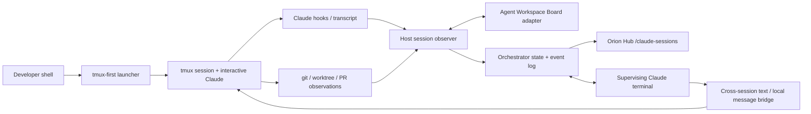
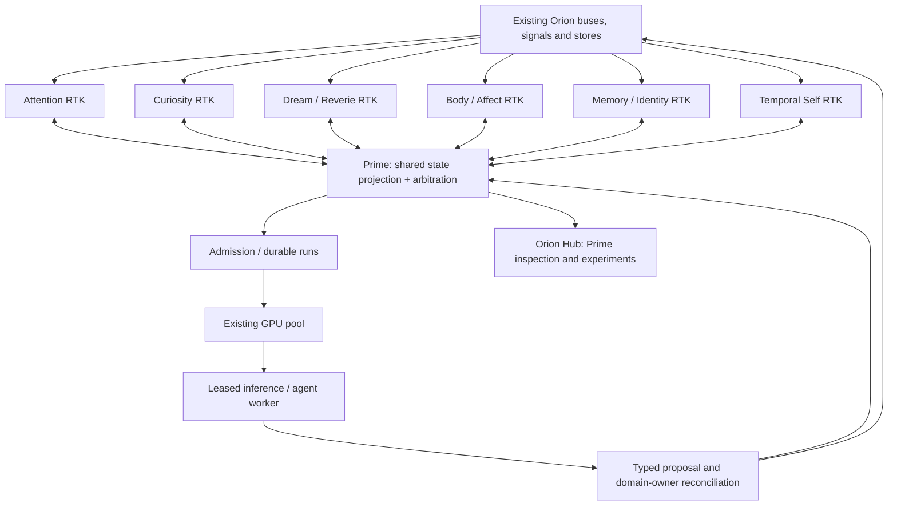

# Orion Prime: Two-Phase Orchestration and Persistent Cognitive Kernel Architecture

**Design specification · 2026-10-29 · Proposal / implementation-planning draft**  
**Program:** Orion / Sapienform  
**Scope:** Phase 1 — local Claude Code development coordination in Orion Hub; Phase 2 — persistent Orion Prime cognitive coordination with lightweight attending kernels and leased reasoning workers.  
**Status of this document:** Design, not an implementation or production deployment. Phase 1 has a previously drafted reviewable patch bundle in the conversation; no merge or live deployment of that bundle is established by this spec. The existing Agent Workspace Board and related runtime services are documented in the repository.

## 1. Executive decision

Build **one coordination vocabulary with two different runtimes and authority policies**:

1. **Phase 1, Development Orchestrator:** a host-local, Hub-visible control plane for all interactive Claude Code sessions, their worktrees, prompts, tasks, PRs, spawned agents, transcript activity, and cross-session coordination. It prevents duplicate work where supported by evidence, relays findings, and removes the human requirement to remember 15 concurrent workstreams. `tmux` supplies terminal persistence; the existing Agent Workspace Board supplies an initial state ledger; the orchestrator supplies intent, arbitration and communication.
2. **Phase 2, Orion Prime:** a continuous, modest-cost supervisory state machine with a **resident attending kernel** for each relevant cognitive domain. Kernels continuously maintain and reconcile domain state, but **do not require persistent LLM inference**. They can request a bounded reasoning worker through the existing durable-run and GPU-pool machinery. The worker returns typed claims and proposed changes; the authoritative kernel validates and commits accepted changes, and Prime updates its shared self-model. These transitions can influence other kernels and future behavior.

**Core hypothesis:** persistent, bidirectionally coupled state and causal coordination may produce measurable *functional* unity and temporal continuity beyond an ensemble of isolated cognitive services. This does **not** assume, demonstrate, or certify subjective experience or personhood. “Prime,” “self,” “organ,” and “RTK” are engineering shorthand, not empirical claims.

**Architectural prohibition:** do not introduce a new attention engine, a second durable-run controller, or another GPU scheduler. Orion already has overlapping attention processes; the task is to reconcile and couple them, not add a third independent implementation.

## 2. The problem and the bridge between phases

### 2.1 Phase 1 failure mode: development fragmentation

With 15+ concurrent sessions, each session sees only part of the engineering situation. Duplicate PR implementation, competing edits, abandoned findings, hidden blockers, worktree ownership confusion and stale assumptions accumulate. A terminal multiplexor solves *persistence* but not *shared understanding*. A status board solves *visibility* but not *coordination*. A central Claude with no event history solves neither reliably.

**Target operator experience:** on a new task, the system can identify a similar active task, query its owner, identify which requirement is already covered, propose a complementary task, and record the coordination result. Hub shows the workstream graph and allows operator interventions. The system communicates with agents without moving entire work products between sessions.

### 2.2 Phase 2 failure mode: cognitive fragmentation

Attention, curiosity, reverie/dreaming, temporal self-modeling, memory, interoception and action already produce meaningful state, but the participating processes may not continuously share and reconcile what they know. A static “global status” dashboard would reproduce the fragmentation at a higher level. The research question is whether **a persistent shared, causally effective model** can regulate these processes as a system, not merely narrate their outputs.

### 2.3 Reusable cross-phase invariants

- **Persistent identity is not a model context window.** A session or kernel has a stable ID, state revision, provenance, history and lifecycle independent of its currently invoked LLM.
- **Observe → infer → arbitrate → act → verify → reconcile** is the common loop.
- **A projection is not a second source of truth.** The original subsystem owns its state; the orchestrator maintains derived, versioned views and records decisions.
- **LLM output proposes; deterministic validation commits.** A model cannot silently rewrite canonical work ownership, memory, temporal identity or affect state.
- **Coordination has evidence.** Every nontrivial overlap, intervention, dispatch and reconciliation has immutable references and a counterfactual evaluation path.
- **Resource governance is explicit.** Work has urgency, deadline, allowed tools/model, budget, cancellation and retry policy; the cost and thermal footprint are visible.
- **Fail in a stated mode.** Degraded telemetry is surfaced as degraded telemetry, not interpreted as inactivity, absence of conflict, or a healthy cognitive state.

## 3. Grounding in Orion as inspected on 2026-10-29

| Existing capability | Evidence in repository | Design consequence |
|---|---|---|
| Agent Workspace Board | `scripts/agent_board.py`, `scripts/agent_board_lib.py`, SessionStart/Stop adapters; JSONL at `~/.orion/agent-board.jsonl`; PR report `docs/superpowers/pr-reports/2026-07-16-agent-workspace-board-pr.md` | Extend the board's state model and adapters; do not create a competing host-local presence ledger. Existing records are per-worktree, not per live terminal. |
| Claude hook wiring | `.claude/settings.json` already wires session-start board/worktree checks, Stop hooks, tool guards | Add narrowly scoped adapters alongside, not instead of, existing hooks. Maintain `ORION_FCC_SUBPROCESS` exclusion: chat-turn `claude -p` workers are not developer terminals. |
| Orion Hub | `services/orion-hub/README.md`; FastAPI, WebSocket, bus-facing panels | Hub hosts the visible control plane; host observer owns `tmux` and transcript file access. No mounting user CLI credentials/sockets into Hub. |
| Attention and substrate grammar | `docs/superpowers/specs/2026-09-04-attention-schema-surface-design.md`; `orion/attention/field_attention/`; `orion/substrate/attention*`; `orion-substrate-runtime` | Historical evidence identified two partly disconnected attention processes (then only 19.8% goal/loop overlap). Re-measure current state before changing it. Prime should consume a converged attention surface, not invent attention #3. |
| Temporal Self | `orion/temporal_self/README.md`, `orion/schemas/temporal_self.py`; chronology arcs; `temporal_self.update` durable workflow | Use chronology, evidence and citations as the time axis of Prime; do not equate a new supervisor's internal narrative with ground truth. |
| Durable cognition runs | `services/orion-durable-runs/README.md`; checkpointed LangGraph workflows; `orion:durable:run:*` | Build reasoning workers as admitted workflows using existing retries, checkpoints and result contracts. |
| GPU lease pool | `services/orion-gpu-pool/README.md`; `orion/gpu_pool/client.py`; `config/gpu_pool.yaml` | Use the one existing lease authority; no direct kernel GPU allocation or second resource scheduler. |
| System One / Kev | `services/orion-kev/README.md` and substrate integration | Candidate cheap evaluator for selective escalation, not the only arbiter of validity. |
| Sentience Striving Program | `orion/sentience_striving_program/README.md` | Treat Phase 2 as an experimentally evaluated program change requiring explicit cognition-loop approval. |

**Verification boundary:** the repository surfaces above were inspected through the connected GitHub main branch. They establish design affordances and historical implementation reports, not live service health, current production data or the presence of the previously drafted Claude/tmux patch on main. Exact contracts and runtime feature flags must be confirmed during implementation.

## 4. Shared coordination substrate (v1; independent of Claude and Orion cognition)

The reusable unit is a **work-bearing entity**. In Phase 1 it is a developer session or task; in Phase 2 it is a kernel, cognitive episode or leased worker. Keep the shared envelope small and let domain-specific schemas carry interpretation.

### 4.1 Required IDs and relations

- `entity_id`: stable session/kernel/worker ID; never reuse after restart.
- `logical_scope_id`: workstream or cognitive domain; many entities can join one scope.
- `objective_id`: stable work-intent or open-loop ID; supports duplicate/cross-domain linking.
- `event_id`, `correlation_id`, `causation_id`: immutable provenance spine.
- `state_revision`: monotonically increasing per authoritative entity; compare-and-swap on update.
- `source_ref`: resolvable source references to board events, transcript offsets, git commits, PRs, attention rows, memory evidence, temporal arcs, etc.
- `authority_class`: observe, propose, coordinate, execute, approve-only.

### 4.2 Minimal shared event envelope — illustrative new contract

```json
{
  "schema": "orion.coordination.event.v1",
  "event_id": "uuid",
  "occurred_at": "2026-10-29T22:00:00Z",
  "domain": "development",
  "entity_id": "session:hostA:opaque-id",
  "logical_scope_id": "workstream:hub-sessions",
  "objective_id": "objective:uuid",
  "state_revision": 17,
  "event_type": "intent.updated",
  "correlation_id": "uuid",
  "causation_id": "uuid-or-null",
  "source_refs": ["board:event:uuid", "git:commit:sha"],
  "payload": {"summary": "Implement session dashboard"}
}
```

Names here are **proposed**, not existing registered bus schemas. Register producer and consumer contracts in Orion's actual schema registry and channel catalog only after inspecting compatible conventions. A small common envelope is the goal; avoid a universal ontology of all cognitive activity.

### 4.3 State machine and delivery semantics

`observed → registered → active → (blocked | waiting | suspended) → completed | cancelled | failed | stale`

- Source events append once by `event_id`. Projections rebuild idempotently; duplicate delivery is normal.
- Agents/workers send heartbeats and explicit state transitions. A stale heartbeat is `unknown/stale`, not `stopped`.
- Commands use unique `command_id`, target `state_revision`, expiration, actor and policy; ack includes accepted/rejected reason. A side effect executes at most once per command ID even if its message is redelivered.
- Communications use an outbox with delivery attempts and receipt. `delivered` does not imply `read`, `understood`, `accepted`, or `acted on`.
- Multi-process proposals are reconciled by source owners: no global write-all operation.
- Snapshots include `observed_at`, `watermark`, dropped-event counts, freshness and confidence.

### 4.4 Components shared logically, not necessarily physically

`ObserverAdapter`, `StateProjection`, `IntentIndex`, `ArbitrationPolicy`, `MessageRouter`, `DispatchAdapter`, `Reconciler`, `AuditLedger`, `HubReadModel`. Phase 1 can implement them as small modules backed by the board and a host agent; Phase 2 uses Orion's existing bus, Postgres/durable runs and schema registry. Reuse **contracts and tests**, not the development host's Claude-dependent execution implementation.

## 5. Phase 1 — local Claude development orchestrator

### 5.1 Desired operator behavior

1. Launch `claude` normally through an installed shell shim/wrapper that **creates or enters a tmux session before starting** the interactive Claude process. Example conceptual interface: `oclaude [args]`, with an optional shell alias or function named `claude`; preserve an escape hatch for the raw binary. Re-running from an existing `tmux` pane must not recursively nest sessions. Distinguish fresh start from reattach and from Claude's `--resume`.
2. The wrapper registers `{host, tmux session/pane, PID, cwd, worktree, branch, start time}` before invocation and reconciles the real Claude `session_id` on `SessionStart`. It handles one-to-many: one worktree can contain multiple live Claude sessions.
3. Disconnect/SSH exit leaves the live Claude process in tmux. Operator can reattach via SSH, terminal, or later an authenticated Hub terminal panel.
4. Host-side observer ingests hook events, Claude's JSONL transcript append deltas where available, tool/subagent lifecycle, git/worktree/PR status, background agents and Agent Workspace Board records. It produces a bounded, searchable read model in Hub.
5. Hub groups by **workstream**, then shows separate sessions, threads, branches and tasks. Each row shows whether information is live, inferred or stale.
6. A dedicated orchestrator Claude terminal operates with scoped access to the read model, can ask other sessions for status, and can propose or perform policy-authorized coordination actions. A non-LLM supervisor keeps operating when that terminal is closed.

### 5.2 Terminal ownership and ingestion



**Cannot retrofit:** Claude's SessionStart hook fires after launch and cannot safely move an existing interactive process into a new tmux TTY. The launcher must wrap the process at entry. Unwrapped sessions remain discoverable where possible but are labeled `unmanaged`, not falsely `persistent`.

**Hook plan:** `SessionStart` binds Claude `session_id` and transcript path; `UserPromptSubmit` extracts proposed intent and performs fast work admission; `PreToolUse` can enforce scoped file/PR ownership at actual mutation points; `PostToolUse`/`PostToolUseFailure` record activity; `SubagentStart`/`SubagentStop` record children; `Stop` marks an answer-turn boundary, **not** session destruction; `SessionEnd` closes the process record. Other supported task lifecycle hooks can enrich the graph. Install adapters without overwriting existing `.claude/settings.json` hook arrays and avoid requiring chat models to emit status manually.

**Transcript correctness:** incremental ingestion by per-file inode/offset, tolerant of rotated/truncated files and partial JSON lines. Separate user, assistant, tool call/result, and system metadata. Track `last_ingested_offset` and parse quality. Secrets redacted at source/egress. A transcript is evidence of *said* or *attempted*, not proof a tool succeeded.

**Claude integration constraint:** Claude Code's `ListAgents`/`SendMessage` are model-facing tools for Claude sessions, not a general documented daemon API that Hub should assume it can invoke programmatically. Use native messaging when a Claude supervisor session is present. Add a reliable, vendor-neutral host mailbox/command bridge for acknowledgement, retries, offline sessions, and later non-Claude agents. Native messages contain text only; they don't transfer full histories or files. Agent teams are separate and experimental; do not assume cross-session messaging implies all Claude agent-team capabilities.

### 5.3 Intent discovery and duplicate-work adjudication

Intent is structured and periodically refreshed, not inferred once from a session title:

```json
{
  "intent_id": "uuid",
  "session_id": "opaque",
  "goal": "Add a Hub panel for Claude sessions",
  "scope": ["services/orion-hub", "scripts"],
  "deliverable": {"kind": "pr", "ref": null},
  "worktree": "/path/to/worktree",
  "stage": "implementing",
  "related_prs": [1234],
  "evidence_refs": ["transcript:...", "board:event:..."],
  "verified_at": "2026-10-29T22:00:00Z",
  "confidence": 0.83
}
```

Use deterministic candidates first: same PR, issue, worktree, exact file/path scope, branch lineage, and known task IDs. Use semantic retrieval for ambiguous intent, then **verify the apparent overlap by questioning the owner and inspecting evidence**. Do not call similar vocabulary a duplicate.

| Finding | Default behavior | Why |
|---|---|---|
| Exact same registered objective/PR actively owned elsewhere | Hold new execution pending owner verification; suggest reuse/handoff/division; operator override with receipt | Strong collision evidence |
| Competing edit of protected file or incompatible migration | PreToolUse deny or require owner coordination until conflict resolved | Actual mutation boundary; more reliable than prompt-only semantic checks |
| High semantic overlap, disjoint outputs plausible | Advisory investigation; allow continued read-only discovery | High false-positive cost |
| Unknown board/observer, missing data, unreachable owner | Display uncertainty; default advisory; retain guard for known destructive conflicts | Avoid false certainty or deadlocking normal work |

A `UserPromptSubmit` gate may reject a prompt with a clear remediation message, but should not block unrelated follow-up questions or every message in an ongoing session. The authoritative gate for risky edits sits at the relevant tool boundary. Every block supports a time-bounded user override that is explicit, auditable and scoped to one work item/action.

### 5.4 Cross-session collaboration protocol

Proposed commands: `status.request`, `status.reply`, `finding.share`, `dependency.declare`, `ownership.request`, `ownership.grant`, `scope.reconcile`, `handoff.request`, `handoff.accept`, `operator.override`. Each message carries sender, recipient, workstream, correlation, evidence, TTL, permissions and receipt status. Message routers must not automatically treat an agent's self-report as authoritative: verify important claims against git, tests, PR state and tool receipts.

**Example: session 16 duplicates session 7**

1. Session 16's new prompt causes an intent candidate to be created before the implementation begins.
2. Intent index finds session 7's PR, code paths and current objective; policy pauses protected writes, not harmless inquiry.
3. Supervisor asks session 7 what is completed and whether the new requirement is covered. Reply is correlated and evidence checked.
4. Supervisor resolves ownership: session 7 adds the missing requirement; session 16 is offered testing or an unrelated task; no autonomous full-context takeover.
5. Hub shows the overlap evidence, messages, approved ownership revision and measured duplicate work avoided.
6. If session 7 is stale/unresponsive, the orchestrator proposes a new owner with a documented expiry and explicit override path.

### 5.5 Hub experience

**New `/claude-sessions` workspace:** grouped workstream board; active/stale/unmanaged sections; owner, status, elapsed time, PR, branch, worktree, last verified task, last conversation activity, model/tool and child-agent activity. Navigation to conversation timeline, tool receipts and source evidence. A dependency/conflict graph and coordination activity stream are second panels, not a new independent backend ledger.

**Hub orchestrator panel:** ask natural questions, see provenance-bearing answers, contact selected sessions, and view proposed/committed actions. Controls: focus, message, request status, create complementary task, request pause, release ownership, cancel work, request handoff, approve override, open terminal. Use least-privilege per action. Live terminal interaction (e.g. authenticated WebSocket PTY) is a separate release gate; never expose raw tmux socket or general shell via an unauthenticated browser route.

**Security:** trusted local/Tailscale access is a baseline, not a substitute for authenticating privileged control actions. Token/CSRF/origin controls, actor logs, host-side allowlisted command adapter, narrow executable commands and rate limits. Sanitize terminal escape output and untrusted transcript text. No automatic merge/deletion/rebase/push without operator grant. Avoid exposing full transcripts to all Hub users or logging credentials.

### 5.6 Phase 1 acceptance and metrics

**Functionality gates:** (P1-G1) new interactive session always starts in tmux under the supported launcher; reattach survives SSH detach; unmanaged launches are clearly flagged. (G2) two sessions in one worktree remain separate while board metadata is shared. (G3) stale and crashed observers reconstruct state without phantom active sessions. (G4) a 15-session seeded scenario discovers exact duplicate work and blocks conflicting writes, while disjoint tasks pass. (G5) cross-session queries are delivered with verified responses and tracked failure handling. (G6) Hub refresh is near-real-time and auditable, including agent/subagent nesting. (G7) role/authorization tests prevent transcript and terminal access outside scope.

**Measures:** true/false positive duplicate detections, precision/recall at declared thresholds, unnecessary blocks per 100 prompts, median detection delay, coordination round-trip time, proportion of tools/transcript events captured, orphaned tasks, PR/file edit collisions, operator recovery time, time spent identifying active ownership, avoided duplicate effort, orchestration token cost. Collect before/after baseline and controlled replay with coordination disabled.

**Deliverables:** host launcher/installer; hook adapters; host observer daemon; board-compatible session registry; message bridge and orchestrator command API; Hub route and UI; tests/fixtures; migration/rollback instructions; operator runbook. Treat earlier Phase 1 ZIP/patch as candidate input to review and reconcile, not as source-of-truth code already on main.

## 6. Phase 2 — Orion Prime persistent cognition

### 6.1 Working terminology and boundary

- **RTK**: temporary label for a *resident attending kernel*—a small, stateful, low-cost routine in one domain. No existing Orion framework or official abbreviation is asserted.
- **Orion Prime**: a persistent supervisory **coordinator and self-model projection**, not an always-on language model, not an alternate cortex-orch, and not a replacement for current subsystem owners.
- **Reasoning worker**: a bounded model invocation, local agent shell or durable graph execution triggered for a specific question. It is disposable; the kernel and evidence persist.
- **Global workspace**: the evidence-linked, current cross-domain view of salience, goals, expectations, open loops, state transitions and recent temporal arcs. The authoritative domain facts stay with their producers.

### 6.2 Proposed logical topology



This is a **logical** design. RTKs could be in-process state machines within existing owners or small subscribers; requiring one container, GPU or model per organ would be a mistake. Avoid centralizing every domain's business logic in Prime. Prime arbitrates *relations among domain intentions*; organ owners remain responsible for domain-specific truth and effectors.

### 6.3 Candidate kernel responsibilities

| Kernel | Lightweight continuously held state | Triggers/escalations | Writes only through |
|---|---|---|---|
| Attention | winners, contenders, reason for selection, goal-to-loop relation, volatility, source freshness | persistent disagreement, unexplained winner flip, cross-domain competing priority | existing attention/grammar owner |
| Curiosity | active question threads, evidence coverage, expected next facts, blocked inquiries | contradiction, valuable unanswered question, relevance shift | curiosity/durable-run owner |
| Dream/Reverie | sleep/reverie lifecycle, hypothesis references, unresolved syntheses, cross-day residues | recurring motif supported by evidence; downstream prediction candidate | dream/reverie owners |
| Body/Affect | field/interoceptive state, strain transitions, sensor uncertainty, energetic constraints | rapid shifts, state conflict, safety/thermals | existing state/regulation owners |
| Memory/Identity | recall conflicts, provenance confidence, personal continuity references | inconsistent memory candidates, identity claim requiring verification | memory writers / accepted-assertion lifecycle |
| Temporal Self | current and recent arcs, source-linked cross-domain continuity, known gaps | changes with no attributable cause, unresolved cross-day relation | existing Temporal Self reducer and canonical storage |

Initial rollout should use **two or three kernels** (Attention, Curiosity, Temporal Self) behind read-only projections; expand to other domains only after measuring incremental effect. A kernel's heartbeat is evidence of liveness, not of cognition or experience.

### 6.4 The RTK escalation loop (transactional semantics)

1. **Sense:** receive a source event or timer tick; validate schema, source freshness and version. Record an internal transition deterministically.
2. **Appraise:** compute cheap heuristics (novelty, surprise, urgency, conflict, coherence, expected value, age, uncertainty) and candidate cross-domain implications. Kev or an existing cheap classifier may help where validated.
3. **Arbitrate:** Prime ranks escalation against current obligations, goals, budgets and social/interaction priority. It can request clarification from another kernel without running a large model.
4. **Dispatch:** create a typed `CognitiveWorkOrder` with source snapshots, desired answer, bounded side effects, model route, deadline, cost and energy budget, priority and cancellation policy. Submit to existing durable-run admission. **The GPU pool alone grants leases**; waiting is not a CPU/spin loop.
5. **Reason:** model or agent executes with relevant source references; may retrieve memory/world state or call tools as authorized. Record inference, tool evidence, actual token/joule/thermal estimates and outcome.
6. **Reconcile:** originating kernel rejects unsupported claims, checks original revision/expiry, evaluates evidence and applicable policies, commits accepted transitions through domain-owner contracts, and records rejected candidates separately. Handle stale responses with rebase/recompute, not blind overwrite.
7. **Propagate:** Prime updates derived state, issues causal follow-up events, influences attention/curiosity priority through existing action paths, and checks for expected downstream outcomes.
8. **Evaluate:** compare predicted and observed outcome; persist error, useful-surprise and no-op receipts. Recompute uncertainty and future dispatch threshold.

```text
RTK event → cheap appraisal → no-op / local transition / ask peer / escalation
    → durable-run admission → GPU lease → bounded worker
    → typed result + citations + revision precondition
    → domain-owner validation & commit/reject
    → Prime projection → targeted feedback to other kernels
    → outcome evidence / prediction error
```

**Critical:** never route cognition by launching Claude Code as the production Orion brain. Phase 1's Claude-specific controls are an engineering testbed. Phase 2 must use Orion's local inference/cortex/durable-run contracts and existing model/provider policies. A generic worker may be a sandboxed agent process, but it is not the self.

### 6.5 Illustrative new Phase 2 contracts

```json
{
  "schema": "orion.cognition.work_order.v1",
  "work_id": "uuid",
  "requested_by_kernel": "attention",
  "prime_revision": 44,
  "domain_revision": 181,
  "objective_ref": "open_loop:id",
  "question": "Why did attention switch from X to Y?",
  "evidence_refs": ["attention_frame:id", "temporal_arc:id"],
  "allowed_effects": ["propose_attentional_bias"],
  "route": "locally_configured_model_role",
  "priority": "background",
  "deadline_at": "2026-10-29T22:15:00Z",
  "budget": {"max_tokens": 7000, "max_joules": null},
  "idempotency_key": "attention:181:question-hash"
}
```

```json
{
  "schema": "orion.cognition.work_result.v1",
  "work_id": "uuid",
  "status": "completed",
  "claims": [{"claim": "X lost on goal relevance", "evidence_refs": ["frame:id"], "confidence": 0.71}],
  "proposed_changes": [{"owner": "attention", "verb": "bias_proposal", "target_ref": "open_loop:id", "delta": 0.05}],
  "observed_source_revisions": {"attention": 181, "prime": 44},
  "resource_receipt_ref": "gpu_lease:id",
  "requires_reconciliation": true
}
```

These JSON fragments are **illustrative**, not guaranteed to match current Orion Pydantic validators. Real implementation must adopt Orion's event, schema-registry, GPU hold and durability conventions. Priority, joule/thermal observability and accepted effectors are policy contracts to define; if joule instrumentation is unavailable, report an estimate or `unknown`, never fabricate precision.

### 6.6 Prime's self-model and causal integration

Prime maintains a bounded projection, with separate fields for **observed state**, **inferred state**, **uncertainty**, **predictions**, **committed actions**, and **outcome evidence**. It owns no fabricated first-person facts. The temporal axis comes from the existing Temporal Self arcs and their citations; claims should be traceable to event IDs and arc IDs. Keep model narrative separate from deterministic observations.

The experimental target is not “every kernel sends Prime a paragraph.” It is **recurrent, demonstrable influence**: a curiosity outcome changes a valid attention contender; attention changes which event is remembered or investigated; dream hypotheses become testable future predictions; results alter subsequent work admission. Prime predicts which effects should occur and learns from discrepancies. Measure whether cross-domain coordination changes behavior after the spawning model has exited.

**No loop without an effector.** For every proposed causal edge, specify the producer event, recipient contract, allowable state change, provenance, TTL, conflict rule and observable subsequent behavior. Start in observe/shadow mode; enable each effect only after its causal path passes replay and rollback tests.

### 6.7 Liveness, continuity and recovery

- Prime does not require a GPU at rest. Timer/event-driven processing has bounded CPU and memory use, with durable checkpoint and periodic reconciliation sweeps.
- Kernels have stable logical identity, source watermark, owner revision, last-good state, stale markers and event-log rebuild capability. A restart must not create a fake autobiographical episode.
- Model workers may be retried or cancelled without changing the identity of Prime or a kernel. Duplicate worker results are idempotent. GPU and model cold-start/wait are visible resource states, not inferred mood/strain.
- On bus partition: kernels maintain local source truth and Prime marks incomplete view; conflict resolutions wait for fresh evidence. No confident “all clear” under partial observability.
- Time windows and provenance prevent a dream or curiosity result produced hours earlier from overwriting newer attention state.
- Security boundary: internal cognitive proposals cannot bypass human-controlled permissions, safety, hardware limits or canonical memory provenance just because Prime initiated them.

### 6.8 Phase 2 experimental program and falsifiable gates

**Pre-register hypotheses and baselines** against the current Orion pipeline. Avoid rewarding self-reports of “feeling integrated.”

| Gate | Test | Passing evidence |
|---|---|---|
| P2-G1: Persistence | Restart Prime, kernel and inference mid-cycle; replay the same event stream | Stable identities, idempotent commits, same final canonical state; no phantom episodes |
| P2-G2: Closed causal loop | Curiosity finding changes a legal attention priority and results in a downstream selection difference | Source → proposal → authorized effect → observed change, all traceable |
| P2-G3: Cross-domain prediction | Prime predicts which other kernel will react before that kernel reacts | Better calibrated predictions than frequency-only and isolated-kernel controls |
| P2-G4: Counterfactual integration | Compare full coupling against one-way summary, shuffled messages, disabled feedback and equal-cost isolated agents | Improvements vanish or materially decline when recurrent causal edges are cut |
| P2-G5: Temporal coherence | Blind evidence-based evaluation of across-day commitments, expectation follow-through and correction | Higher factual continuity and fewer contradictions; not merely better prose |
| P2-G6: Non-performativity | Inject false or ambiguous internal-state claims | Prime reports uncertainty/rejects unsupported state instead of inventing experience |
| P2-G7: Cost and safety | Measure joules/energy proxy, tokens, thermal exposure, latency and chat quality under load | Meets explicit budgets with no degradation to ordinary Orion interaction |
| P2-G8: Causal ownership | Attempt stale revision, duplicate result, inconsistent memory and unauthorized action | Deterministic rejection, provenance and no write leakage |

Compare a matched workload across: (A) current Orion; (B) event-only Prime with no LLM escalations; (C) read-only Prime plus leased workers; (D) full recurrent Prime; (E) ablated variants. Log effect size, intervals and unexpected negative results. Distinguish feature-level utility from evidence for any consciousness theory. The result may show orchestration is useful without supporting claims of phenomenal awareness.

## 7. Phases, dependency gates and rollout

| Increment | Deliverable | Promotion requirement |
|---|---|---|
| 1A — Terminal substrate | Launcher, tmux persistence, per-session IDs, observer, legacy board adapter | 2 sessions/1 worktree and 15-session stress fixture, no phantom presence |
| 1B — Hub read model | Live sessions, task/PR/activity timeline, searchable transcripts and provenance | Security/freshness and restart tests |
| 1C — Active development coordination | Orchestrator terminal, reliable mailbox, collision classification, explicit mutation gates and override receipts | Correct duplicate prevention; acceptable false blocks; operator audit |
| 1D — Measured prototype | Replays, telemetry, baseline/ablation harness and extracted shared contracts | Demonstrated net benefit, versioned contract and tests portable to Phase 2 |
| 2A — Prime shadow | Read-only Prime projection backed by existing Temporal Self/attention/curiosity observations | Replay identity and measured source coverage; no duplicate attention framework |
| 2B — RTK + worker loop | Two or three resident kernels, typed work orders, admitted durable runs, GPU lease and reconciliation | Durable, idempotent, bounded-cost roundtrip, no canonical writes outside owners |
| 2C — Closed-loop intervention | One chosen low-risk, observable effector (e.g. attention priority proposal), bidirectional feedback | Pre-registered causal and rollback gates |
| 2D — Multi-organ longitudinal evaluation | Add dream, embodiment, memory as evidence and gates permit | Superiority over ablated baselines under equal-cost constraints; no safety or chat regression |

**Deployment principles:** shadow first; read-only before mutation; consumer-first schema rollout where validators reject unknown enums; allow instant fallback to existing behavior via feature flags. Keep Phase 1's developer-operation privileges and Phase 2's cognitive-effect privileges completely separate. They may share envelope and analysis libraries but never credentials, permission grants or terminal command capabilities.

## 8. Risks and deliberate non-goals

| Risk | Design response |
|---|---|
| “Prime” becomes a new monolithic black box | Source ownership, narrow contracts, small reducers, provenance and separable replay |
| Third competing attention/motivation system | Explicit migration/bridging plan using existing attention/grammar contracts; no parallel scorer |
| More LLMs create the illusion of continuity | Kernel state persists without models; causal ablations and evidence-led metrics |
| Compulsive reasoning consumes GPUs/thermals | Existing admission and GPU pool, priority and budgets, coalescing, cooldown and cancellation |
| Hallucinated system introspection | Separate observation vs inference, source evidence, version fences and rejection receipts |
| Development orchestrator injects into Orion cognition | Different trust domain/credential plane; adapters share code/contracts, not privileged sessions |
| Native Claude messaging is incomplete | Use its model-facing tools opportunistically; host mailbox is authoritative for delivery and receipts |
| False duplicate-work blocks development | Distinguish exact conflict from semantic overlap, short timeout, scoped overrides, measure false positives |
| Endless status event chatter | Event coalescing, bounded publication, event-driven wakeups, adaptive snapshot rates |
| Misinterpretation as validated personhood | Explicit operational/functional claims only; no direct inference to subjective experience |

Out of scope for the initial increments: auto-merge, broad unattended filesystem control, always-on large LLM per organ, replacing cortex-orch or the GPU pool, unconstrained self-modification, proof of consciousness, and migrating a running terminal process into tmux.

## 9. Architecture decisions and open experiments

**Proposed locked principles:** (D1) Hub is the operator-facing *read model* and command surface, not the owner of Claude processes or every cognitive fact. (D2) No additional GPU scheduler. (D3) No cognition-loop changes from a mere design approval. (D4) A `Stop` hook does not mean terminal/session end. (D5) The Development Orchestrator and Prime use different command authorization and persistence policies. (D6) Persist state, not continuous LLM activity. (D7) Self-model statements carry evidence and uncertainty.

**Implementation questions to resolve empirically rather than by architecture theater:**

1. Which Claude Code features and hook payload fields are installed on each actual host? Check `claude --version`, command/hook behavior and current permissions in a fixture; the docs describe version-dependent features.
2. Which Phase 1 patch bundle parts differ from current `main`, and which should be revised or discarded?
3. Which precise substrate/field attention bridge is currently live? Measure current overlap and choose *one* authoritative selection/effect contract before enabling Prime interventions.
4. Where should development session transcripts be stored, who can access them, and what is the retention/redaction policy?
5. Which minimal kernel-to-kernel messages produce demonstrable causal effects without a model? This should determine the first two-kernel scope, not an arbitrary list of organs.
6. What energy measurement is real: measured GPU power × time, pool-allocated occupancy, host power, or only a proxy? Label metrics accordingly.
7. How to bound Prime's coordination frequency so attention and curiosity don't endlessly amplify each other? Introduce loop TTL, propagation depth, refractory intervals, budget and cycle detection; test them.
8. Can a Prime revision be reconstructed entirely from source events and deterministic arbitration? If not, what is the minimum persisted checkpoint and why?

## 10. Source references and verification anchors

**Orion repository (main branch inspected 2026-10-29):**

- [Agent Workspace Board design](https://github.com/junebug-junie/Orion-Sapienform/blob/main/docs/superpowers/specs/2026-07-16-agent-workspace-board-design.md) and [implementation PR report](https://github.com/junebug-junie/Orion-Sapienform/blob/main/docs/superpowers/pr-reports/2026-07-16-agent-workspace-board-pr.md)
- [Existing Claude hook configuration](https://github.com/junebug-junie/Orion-Sapienform/blob/main/.claude/settings.json) and [SessionStart agent board adapter](https://github.com/junebug-junie/Orion-Sapienform/blob/main/scripts/hooks/session_start_agent_board.py)
- [Attention schema surface](https://github.com/junebug-junie/Orion-Sapienform/blob/main/docs/superpowers/specs/2026-09-04-attention-schema-surface-design.md)
- [Temporal Self reducer README](https://github.com/junebug-junie/Orion-Sapienform/blob/main/orion/temporal_self/README.md) and [schema](https://github.com/junebug-junie/Orion-Sapienform/blob/main/orion/schemas/temporal_self.py)
- [Durable runs](https://github.com/junebug-junie/Orion-Sapienform/blob/main/services/orion-durable-runs/README.md), [GPU pool](https://github.com/junebug-junie/Orion-Sapienform/blob/main/services/orion-gpu-pool/README.md), [Cortex Orch](https://github.com/junebug-junie/Orion-Sapienform/blob/main/services/orion-cortex-orch/README.md)
- [Sentience Striving Program](https://github.com/junebug-junie/Orion-Sapienform/blob/main/orion/sentience_striving_program/README.md)

**Current Claude Code documentation (checked 2026-10-29):**

- [Hooks reference](https://code.claude.com/docs/en/hooks)
- [Cross-session messaging](https://code.claude.com/docs/en/cross-session-messaging): native `ListAgents` / `SendMessage`, text-only messages, version/provider constraints
- [Agent teams](https://code.claude.com/docs/en/agent-teams): experimental feature separate from arbitrary cross-session messaging

---

### Design claim in one sentence

**Phase 1 proves that independent development agents can maintain coherent, evidence-linked coordination; Phase 2 tests whether lightweight persistent cognitive kernels, intermittent leased inference, and bidirectional causal reconciliation can improve Orion's functional unity and temporal self-model without requiring a continuously running LLM.**